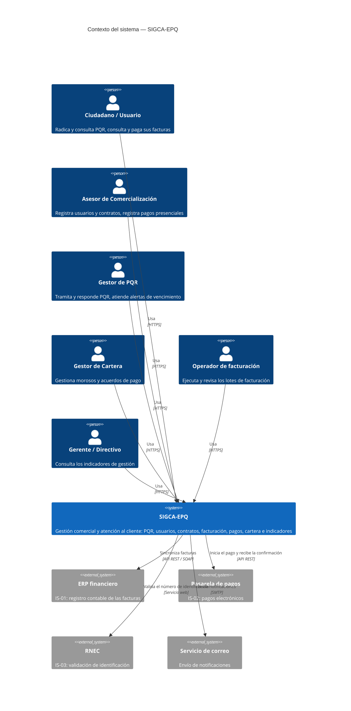
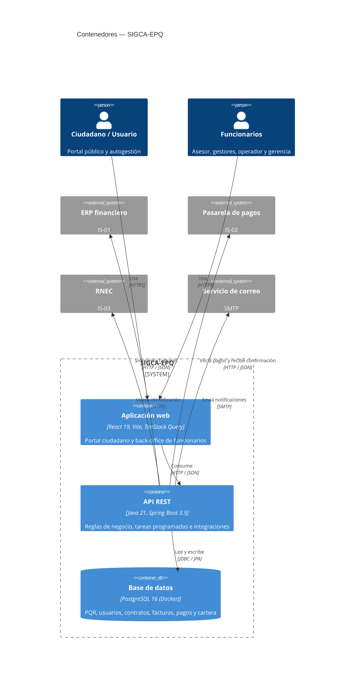
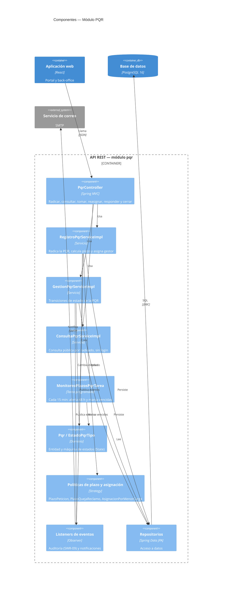
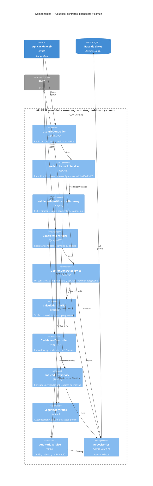
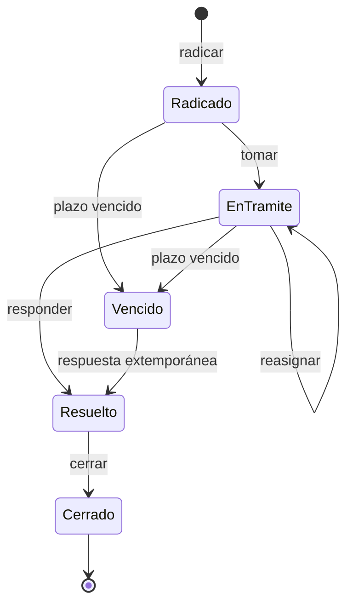
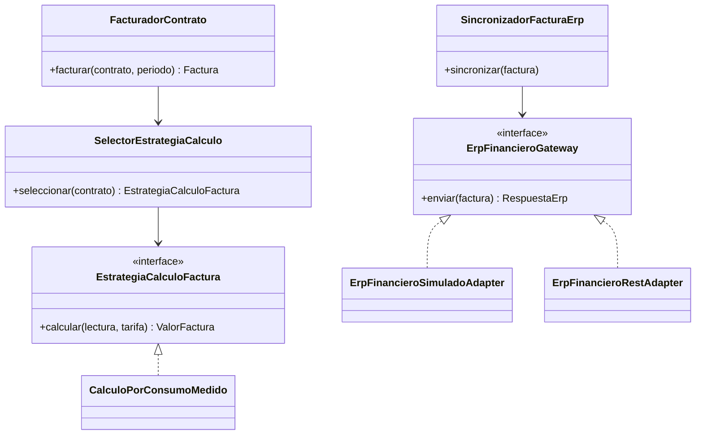
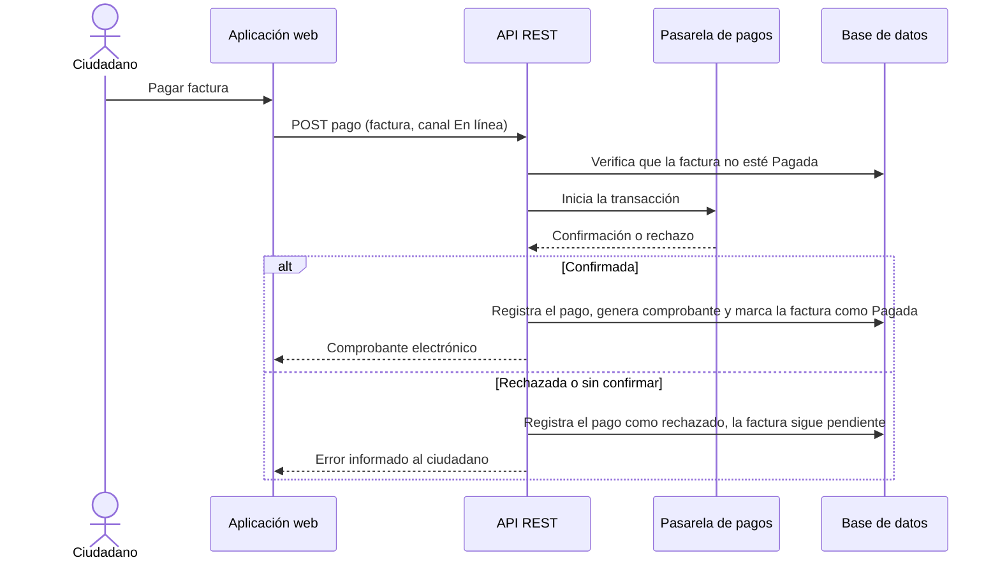
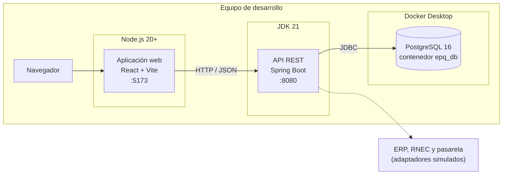

# Documento de Arquitectura de Software — SIGCA-EPQ

**Sistema de Información para la Gestión Comercial y Atención al Cliente de Empresas Públicas del Quindío (EPQ)**
Modelo de documentación: **C4 Model** (Contexto, Contenedores, Componentes y Código)

| | |
|---|---|
| Asignatura | Ingeniería de Software 2 — Universidad del Quindío |
| Versión | 0.1 |
| Fecha | 2026-10-15 |
| Funcionalidades cubiertas | F-01 a F-08 |
| Equipo | Angelica María Reyes, Steven Severino, Andrés Felipe Zambrano |

> **Cómo leer este documento.** Los diagramas se escriben en Mermaid y se visualizan directamente en GitHub.
> Cada nivel del C4 amplía el anterior: el **nivel 1** muestra el sistema y su entorno, el **nivel 2** los
> bloques desplegables, el **nivel 3** los componentes internos del API y el **nivel 4** detalles de código.
> Los elementos marcados como *(propuesto)* corresponden a F-03 a F-08 y se derivan de los requisitos; deben
> contrastarse con la implementación real del backend.

---

## 1. Introducción

### 1.1 Propósito

Describir la arquitectura de SIGCA-EPQ: sus elementos, cómo se relacionan y por qué se tomaron las decisiones
principales, de modo que el equipo, el docente y futuros mantenedores compartan una misma visión del sistema.

### 1.2 Alcance

| ID | Funcionalidad | Requisitos de software |
|---|---|---|
| F-01 | Generar facturas mensuales | SWR-01 a SWR-04 |
| F-02 | Registrar y dar seguimiento a PQR | SWR-05 a SWR-09 |
| F-03 | Registrar usuario del servicio (validación RNEC) | SWR-12 a SWR-16 |
| F-04 | Gestionar contrato de servicio | SWR-17 a SWR-20 |
| F-05 | Registrar pago de factura | SWR-21 a SWR-24 |
| F-06 | Consultar factura e historial de consumos | SWR-25 a SWR-28 |
| F-07 | Gestionar cobro persuasivo | SWR-29 a SWR-32 |
| F-08 | Consultar dashboard gerencial | SWR-33 a SWR-35 |

### 1.3 Referencias

- Plan de Requisitos (BR, StR, SyR, SWR) y product backlog (SCRUM-5, 6, 10 a 15).
- Student book de Ingeniería de Software 1 (casos de uso, reglas de negocio RN, diagramas de estado DE).
- `README.md` del repositorio (puesta en marcha, pruebas y trazabilidad de F-01 y F-02).

---

## 2. Requisitos arquitectónicamente significativos

Son los requisitos que más condicionan el diseño; de ellos salen las decisiones de la sección 8.

| Atributo | Requisito | Fuente | Efecto en la arquitectura |
|---|---|---|---|
| Rendimiento | El lote mensual de facturas termina en ≤ 60 min | SWR-02 | Proceso por lotes con una transacción por contrato y medición de tiempo |
| Rendimiento | Búsqueda de usuarios y consultas de factura en ≤ 3 s | SWR-16, SyR-06d | Índices en la base de datos y paginación en el API |
| Disponibilidad | Portal de autogestión disponible 24 h | BR de F-06 | Portal ciudadano separado del back-office y consulta de PQR sin login |
| Tolerancia a fallos | Continuar si la RNEC no responde; reintentar al ERP | SWR-14, SWR-04 | Integraciones detrás de interfaces, con estados "pendiente" y bitácora de reintentos |
| Integridad | Radicado único, un contrato activo por predio y servicio, un pago por factura | SWR-05, RN-01, SWR-23 | Restricciones únicas en la base de datos y validación en el dominio |
| Seguridad | Acceso por rol; la factura pasa a "Pagada" solo con confirmación de la pasarela | SWR-15, SWR-29, SWR-33, RN-05 | Capa de seguridad en el API; el frontend nunca decide el estado de la factura |
| Trazabilidad | Auditoría de PQR, usuarios y contratos | SWR-09, SyR-03d, SWR-20 | Eventos de dominio y tabla de auditoría |
| Privacidad | Minimización de datos personales (Ley 1581 de 2012) | StR del proyecto | DTO propios: la API no expone entidades ni datos innecesarios |
| Usabilidad | Accesibilidad orientada a WCAG 2.1 AA | RNF-03 | Frontend responsive y accesible |
| Extensibilidad | Nuevas tarifas, canales y proveedores externos sin reescribir | SWR-03, IS-01 a IS-03 | Patrones Strategy y Adapter |

---

## 3. Nivel 1 — Diagrama de contexto

Muestra **quién usa el sistema** y **con qué sistemas externos se comunica**, sin entrar en detalles técnicos.

| Elemento | Tipo | Responsabilidad |
|---|---|---|
| Ciudadano / Usuario | Persona | Portal público: radicar y consultar PQR sin login; consultar y pagar facturas autenticado |
| Asesor de Comercialización | Persona | Alta y actualización de usuarios y contratos; pagos presenciales |
| Gestor de PQR | Persona | Bandeja de PQR asignadas, respuesta y cierre |
| Gestor de Cartera | Persona | Reporte de morosos, acuerdos de pago, candidatos a suspensión |
| Operador de facturación | Persona | Generación y seguimiento de lotes |
| Gerente / Directivo | Persona | Dashboard gerencial (solo lectura) |
| ERP financiero | Sistema externo | Recibe las facturas generadas para el registro contable |
| Pasarela de pagos | Sistema externo | Procesa el pago en línea y confirma la transacción |
| RNEC | Sistema externo | Confirma que la identificación existe |
| Servicio de correo | Sistema externo | Entrega las notificaciones a ciudadanos y funcionarios |

> El rol **Administrador del Sistema** (SWR-15) comparte las pantallas del Asesor y además puede modificar
> datos de usuarios y contratos; se omite del diagrama para no saturarlo.

---

## 4. Nivel 2 — Diagrama de contenedores

Un *contenedor* es una aplicación o almacén de datos que se ejecuta por separado. Aquí el sistema se divide en
tres: la aplicación web, el API y la base de datos.

| Contenedor | Tecnología | Responsabilidad | Puerto (desarrollo) |
|---|---|---|---|
| Aplicación web | React 19, Vite 8, React Router, TanStack Query, CSS propio | Pantallas del portal ciudadano y del back-office; no contiene reglas de negocio | 5173 |
| API REST | Java 21, Spring Boot 3.5 (Web, Data JPA, Validation, Actuator), springdoc-openapi | Reglas de negocio, validaciones, seguridad, auditoría, tareas programadas e integraciones | 8080 |
| Base de datos | PostgreSQL 16 en Docker | Persistencia relacional con restricciones de integridad | configurable (`POSTGRES_PORT`) |

**Tareas programadas.** Se ejecutan dentro del API (no son un contenedor aparte): facturación diaria a la
1:00 a. m. (genera el lote solo en el primer día hábil del mes), monitoreo de plazos de PQR cada 15 minutos y,
para F-07, la detección de mora y de cuotas incumplidas *(propuesto)*.

**Integraciones.** El API nunca depende de un proveedor concreto: ERP, RNEC, pasarela y correo se usan a través
de interfaces, con un adaptador simulado para desarrollo y otro real, elegido por configuración.

---

## 5. Nivel 3 — Diagramas de componentes del API

Se acerca al contenedor **API REST**. El código se organiza **por funcionalidad** (`pqr`, `facturacion` y los
módulos nuevos), con capas internas (`web`, `servicio`, `dominio`, `repositorio`, `evento`, `tarea`) y un
módulo `comun` con lo compartido.

### 5.1 Módulo PQR (F-02)

### 5.2 Facturación, pagos y cartera (F-01, F-05, F-06, F-07)

Los componentes de F-01 existen en el código (README, sección 5); los de F-05, F-06 y F-07 son *(propuesto)*.

```mermaid
C4Component
    title Componentes — Facturación, pagos y cartera

    Container(web, "Aplicación web", "React", "Portal y back-office")
    ContainerDb(bd, "Base de datos", "PostgreSQL 16", "")
    System_Ext(erp, "ERP financiero", "IS-01")
    System_Ext(pasarela, "Pasarela de pagos", "IS-02")

    Container_Boundary(api, "API REST — módulos facturacion, pagos y cartera") {
        Component(ctrlFact, "FacturacionController", "Spring MVC", "Lotes, facturas y sincronización")
        Component(generacion, "GeneracionFacturacionServiceImpl", "Facade", "Coordina lote, liquidación y envío al ERP")
        Component(facturador, "FacturadorContrato", "Servicio", "Liquida un contrato: lectura x tarifa vigente")
        Component(estrategia, "EstrategiaCalculoFactura", "Strategy", "CalculoPorConsumoMedido; permite agregar estrato")
        Component(sincro, "SincronizadorFacturaErp", "Servicio", "Envía la factura al ERP con reintentos y bitácora")
        Component(tareaFact, "FacturacionMensualTarea", "Tarea programada", "1:00 a. m.; actúa el primer día hábil")
        Component(consultaFact, "ConsultaFacturaService (propuesto)", "Servicio", "Factura actual, historial 24 meses y PDF (F-06)")
        Component(pagos, "RegistroPagoService (propuesto)", "Servicio", "Pago presencial o en línea; comprobante (F-05)")
        Component(cartera, "AcuerdoPagoService / ReporteCarteraService (propuesto)", "Servicio", "Acuerdos, cuotas y reporte de mora (F-07)")
        Component(tareaMora, "MonitoreoMoraTarea (propuesto)", "Tarea programada", "Cuotas incumplidas y candidatos a suspensión")
        Component(gateways, "ErpFinancieroGateway / PasarelaPagosGateway", "Adapter", "Simulado o REST, según configuración")
        Component(repo, "Repositorios", "Spring Data JPA", "Acceso a datos")
    }

    Rel(web, ctrlFact, "Llama", "JSON")
    Rel(ctrlFact, generacion, "Usa")
    Rel(ctrlFact, consultaFact, "Usa")
    Rel(ctrlFact, pagos, "Usa")
    Rel(ctrlFact, cartera, "Usa")
    Rel(tareaFact, generacion, "Dispara")
    Rel(generacion, facturador, "Por cada contrato")
    Rel(facturador, estrategia, "Calcula el valor")
    Rel(generacion, sincro, "Sincroniza")
    Rel(sincro, gateways, "Envía")
    Rel(pagos, gateways, "Confirma el pago")
    Rel(tareaMora, cartera, "Actualiza estados")
    Rel(facturador, repo, "Persiste facturas")
    Rel(pagos, repo, "Marca la factura como Pagada")
    Rel(cartera, repo, "Lee y escribe")
    Rel(consultaFact, repo, "Lee")
    Rel(repo, bd, "SQL", "JDBC")
    Rel(gateways, erp, "HTTP", "REST")
    Rel(gateways, pasarela, "HTTP", "REST")
```

### 5.3 Gestión comercial y gerencial (F-03, F-04, F-08) y módulo común

Todos los componentes de esta sección son *(propuesto)*, salvo el módulo `comun`, que ya existe.

### 5.4 Responsabilidades por capa

| Capa | Responsabilidad | Regla de dependencia |
|---|---|---|
| `web` | Traducir HTTP a casos de uso: rutas, DTO, validación de formato y códigos de error | Solo conoce `servicio` |
| `servicio` | Casos de uso y transacciones | Depende de `dominio`, `repositorio` y puertos externos |
| `dominio` | Entidades, estados y reglas de negocio | No depende de ninguna otra capa |
| `repositorio` | Acceso a datos (Spring Data JPA, `Specifications`) | Solo conoce `dominio` |
| `evento` | Auditoría y notificaciones desacopladas del caso de uso | Reacciona a eventos de dominio |
| `tarea` | Procesos programados | Invoca servicios; no contiene lógica de negocio |

---

## 6. Nivel 4 — Código (vistas seleccionadas)

El C4 recomienda el nivel 4 solo para las partes con decisiones de diseño relevantes. Se documentan tres.

### 6.1 Máquina de estados de la PQR (patrón State)

Cada estado define qué transiciones permite; una transición ilegal se rechaza en el dominio (HTTP 409).
Diagrama simplificado a partir de DE-02 y del README.

### 6.2 Cálculo de factura y sincronización con el ERP (Strategy y Adapter)

Agregar una fórmula por estrato (SWR-03, RN-08) es crear otra implementación de `EstrategiaCalculoFactura`;
cambiar el ERP simulado por el real es cambiar `app.erp.modo`. Ninguno de los dos cambios modifica el código
existente (principio abierto/cerrado).

### 6.3 Flujo de pago en línea (F-05) *(propuesto)*

Aplica RN-05: la factura solo pasa a "Pagada" cuando la pasarela confirma.

---

## 7. Vista de despliegue

En el prototipo todo corre en la máquina de cada integrante. No se ha definido un entorno de producción.

| Elemento | Cómo se levanta |
|---|---|
| Base de datos | `docker compose up -d` desde la raíz; ejecuta los scripts de `database/init/` la primera vez |
| API REST | `./mvnw spring-boot:run` en `backend/`; lee las credenciales del `.env` de la raíz |
| Aplicación web | `npm run dev` en `frontend/`; apunta al API con `VITE_API_URL` |
| Sistemas externos | Adaptadores simulados; el adaptador REST del ERP se activa con `app.erp.modo` |

---

## 8. Decisiones de arquitectura

| # | Decisión | Alternativas | Justificación |
|---|---|---|---|
| D1 | **Monolito modular** organizado por funcionalidad | Microservicios | Equipo de tres personas y un semestre: un solo despliegue y fronteras claras entre módulos, sin la complejidad operativa de los microservicios. Los módulos pueden extraerse más adelante |
| D2 | **PostgreSQL** (relacional) | MongoDB | Los datos son altamente relacionales (PQR, contratos, facturas, pagos) y necesitan integridad: restricciones únicas, claves foráneas y transacciones ACID |
| D3 | **Integraciones detrás de interfaces** (ERP, RNEC, pasarela, correo) con adaptador simulado y real | Llamadas directas al proveedor | Permite desarrollar y probar sin los sistemas reales y cambiar de proveedor por configuración |
| D4 | **Tareas programadas dentro del API** | Servicio de planificación aparte | Menor complejidad; basta para el volumen del prototipo. Cada tarea delega en un servicio, así que se puede mover después |
| D5 | **Eventos de dominio** para auditoría y notificaciones | Llamadas directas desde el caso de uso | Un fallo al notificar no revierte la operación y el caso de uso no conoce a quién notifica |
| D6 | **Máquina de estados en el dominio** (State) | Validar transiciones en el controlador o en la interfaz | Las reglas viven en un solo lugar y se prueban sin infraestructura |
| D7 | **La interfaz no duplica reglas**: el backend informa las acciones disponibles | Replicar reglas en React | Evita inconsistencias entre frontend y backend |
| D8 | **Una transacción por contrato** en el lote de facturación | Una transacción para todo el lote | Un contrato con error no invalida las demás facturas y el lote puede repetirse sin duplicar |
| D9 | **Indicadores calculados sobre los datos operativos** (consultas agregadas) | Bodega de datos o ETL | Los indicadores reflejan el estado actual sin intervención manual (SWR-34) y sin un proceso adicional |
| D10 | **Docker Compose para la base de datos** | Instalar PostgreSQL en cada equipo | Mismo entorno para los tres integrantes y arranque con un solo comando |

---

## 9. Trazabilidad: requisitos → arquitectura

| Funcionalidad | Contenedores | Componentes principales | Sistemas externos |
|---|---|---|---|
| F-01 Facturas mensuales | Web, API, BD | `FacturacionMensualTarea`, `GeneracionFacturacionServiceImpl`, `FacturadorContrato`, `SincronizadorFacturaErp` | ERP (IS-01) |
| F-02 PQR | Web, API, BD | `PqrController`, `RegistroPqrServiceImpl`, `GestionPqrServiceImpl`, `MonitoreoPlazosPqrTarea`, listeners de eventos | Correo |
| F-03 Registrar usuario | Web, API, BD | `UsuarioController`, `RegistroUsuarioService`, `ValidadorIdentificacionGateway`, `AuditoriaService` | RNEC (IS-03) |
| F-04 Contrato de servicio | Web, API, BD | `ContratoController`, `GestionContratoService`, `CalculadoraTarifa`, `AuditoriaService` | — |
| F-05 Pago de factura | Web, API, BD | `RegistroPagoService`, `PasarelaPagosGateway` | Pasarela (IS-02) |
| F-06 Consulta de factura e historial | Web, API, BD | `ConsultaFacturaService` (incluye PDF) | — |
| F-07 Cobro persuasivo | Web, API, BD | `AcuerdoPagoService`, `ReporteCarteraService`, `MonitoreoMoraTarea` | Correo |
| F-08 Dashboard gerencial | Web, API, BD | `DashboardController`, `IndicadoresService`, seguridad por rol | — |

---

## 10. Riesgos y limitaciones

| Riesgo o limitación | Impacto | Mitigación |
|---|---|---|
| El prototipo no tiene HTTPS ni cifrado de datos (RNF-04, RNF-05) | No cumple la seguridad de un entorno productivo | Definir el despliegue seguro (proxy con TLS, gestión de secretos) antes de producción |
| RNEC, pasarela y ERP son simulados | No se prueba la integración real | Adaptadores intercambiables y pruebas contra un servidor HTTP local |
| Las tareas programadas se ejecutan en el API | Con varias instancias del API se ejecutarían duplicadas | Bloqueo distribuido o un único nodo planificador |
| Lote de 60 minutos no medido con volumen real | El SWR-02 no se ha probado a escala | Prueba de carga con datos sintéticos |
| Mora medida por períodos vencidos sin pagar, no necesariamente consecutivos | Puede diferir de RN-03 en casos límite | Ajustar la regla del cálculo de mora |
| Componentes de F-03 a F-08 marcados *(propuesto)* | La documentación puede divergir del código | Revisar este documento contra la implementación antes de la entrega |
