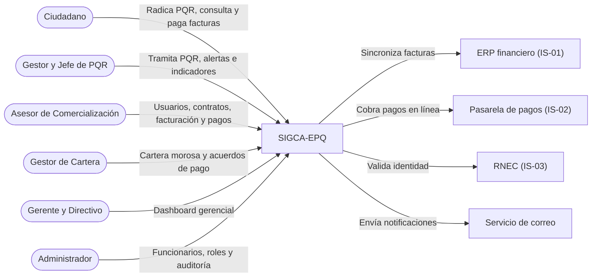
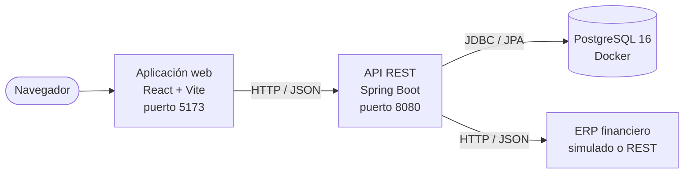

# SIGCA-EPQ

Prototipo del **Sistema de Información para la Gestión Comercial y Atención al Cliente** de
**Empresas Públicas del Quindío (EPQ)**, desarrollado en la asignatura **Ingeniería de Software 2** de la
Universidad del Quindío. Continúa el análisis del proyecto de Ingeniería de Software 1 (student book).
La **entrega 1** implementó F-01 y F-02; la **entrega 2** implementa **todas las funcionalidades** del Plan de
Requisitos (F-01 a F-08) en el backend y en el frontend, con autenticación y control de acceso por roles:

| Funcionalidad | Descripción | Requisitos |
|---|---|---|
| **F-01** Generar facturas mensuales | Facturación automática desde el primer día hábil del mes, tarifa por servicio, municipio y estrato, sincronización con el ERP, auditoría del proceso, anulación y PDF | RF-05, CU-03, SWR-01 a SWR-04, SWR-10, IS-01 |
| **F-02** Registrar y dar seguimiento a PQR | Radicación, asignación al gestor del municipio, plazos en **días hábiles**, alertas al gestor y al jefe, evidencias de la respuesta e indicador de cumplimiento | RF-08 a RF-10, CU-06, CU-07, RN-04, RN-06, DE-02, SWR-05 a SWR-09, SWR-11 |
| **F-03** Registrar usuario del servicio | Registro con predio, identificación única, validación contra la RNEC y búsqueda | RF-01 a RF-03, CU-01, SWR-12 a SWR-16, IS-03 |
| **F-04** Gestionar contrato de servicio | Contratos sin duplicados por predio y servicio, tarifa automática, medidor obligatorio y cambios de estado con historial | RF-04, CU-02, RN-01, RN-08, SWR-17 a SWR-20 |
| **F-05** Registrar pago de factura | Pagos presenciales y en línea con pasarela, comprobante electrónico y canal del pago | RF-06, CU-04, RN-05, SWR-21 a SWR-24, IS-02 |
| **F-06** Consultar factura e historial | Portal del ciudadano: factura actual, historial de 24 meses, PDF y fecha estimada de disponibilidad | RF-07, CU-05, SWR-25 a SWR-28 |
| **F-07** Gestionar cobro persuasivo | Reporte de cartera morosa (PDF/Excel), acuerdos de pago, incumplimiento y candidatos a suspensión | RF-11, RF-12, CU-08, RN-03, RN-07, SWR-29 a SWR-32 |
| **F-08** Consultar dashboard gerencial | Indicadores comerciales, de facturación, cartera y PQR con tendencia de 12 meses | RF-13, CU-09, SWR-33 a SWR-35 |
| Transversal | Login con JWT, bloqueo por intentos fallidos, roles y log de auditoría | RF-14, RF-15, RNF-05 |

> **Corrección de la entrega 1:** los plazos de las PQR se cuentan en **días hábiles** (lunes a viernes, sin
> festivos colombianos), desde el día siguiente a la radicación: 10 para peticiones y 15 para quejas y reclamos.
> Los datos de prueba de la entrega 1 calculaban las fechas sumando días calendario; ahora la base de datos tiene
> las mismas funciones de calendario laboral que el backend (`database/init/00_funciones_calendario.sql`) y hay
> pruebas que lo verifican (ver sección 5, SWR-06).

---

## Contenido

1. [Estructura del repositorio](#1-estructura-del-repositorio)
2. [Stack tecnológico](#2-stack-tecnológico)
3. [Arquitectura](#3-arquitectura)
4. [Puesta en marcha](#4-puesta-en-marcha)
5. [Matriz de trazabilidad](#5-matriz-de-trazabilidad)
6. [Pruebas](#6-pruebas)
7. [Patrones de diseño](#7-patrones-de-diseño)
8. [Buenas prácticas](#8-buenas-prácticas)
9. [Alcance y decisiones del prototipo](#9-alcance-y-decisiones-del-prototipo)
10. [Solución de problemas](#10-solución-de-problemas)
11. [Flujo de trabajo con Git](#11-flujo-de-trabajo-con-git)
12. [Equipo](#12-equipo)

---

## 1. Estructura del repositorio

```
.
├── backend/                  API REST en Spring Boot → ver backend/README.md
│   ├── src/main/java/        Código fuente (comun, seguridad, auditoria, facturacion, pqr, comercial, pagos, portal, cartera, dashboard)
│   └── src/test/java/        Pruebas unitarias y de capa web
├── frontend/                 Aplicación web en React → ver frontend/README.md
│   └── src/                  Portal ciudadano y back-office
├── database/
│   └── init/
│       ├── 00_funciones_calendario.sql  Calendario laboral colombiano en SQL (días hábiles y festivos)
│       ├── 01_schema.sql                Esquema de la entrega 1: PQR + Facturación
│       ├── 02_seed_data.sql             Datos de prueba de la entrega 1 (plazos en días hábiles)
│       ├── 03_schema_entrega2.sql       Tablas de F-03 a F-08, seguridad y auditoría
│       └── 04_seed_entrega2.sql         Funcionarios, municipios, 24 meses de historial, pagos, mora y acuerdos
├── postman/
│   ├── SIGCA-EPQ.postman_collection.json      Colección de pruebas de la API (134 peticiones)
│   ├── SIGCA-EPQ-local.postman_environment.json
│   └── evidencia-respuesta.pdf                Archivo de ejemplo para adjuntar evidencias de PQR
├── docker-compose.yml        Contenedor de PostgreSQL
└── .env.example              Plantilla de variables de entorno
```

| Documento | Contenido |
|---|---|
| [`backend/README.md`](backend/README.md) | Usuarios de prueba, matriz de permisos por rol, endpoints, arquitectura, patrones, SOLID, decisiones, cambios para el frontend y limitaciones |
| [`frontend/README.md`](frontend/README.md) | Usuarios de prueba, pantallas por rol con sus requisitos, arquitectura del frontend, sesión y permisos, sistema visual, accesibilidad y convenciones |

---

## 2. Stack tecnológico

| Capa | Tecnologías |
|---|---|
| Base de datos | PostgreSQL 16 en Docker |
| Backend | Java 21, Spring Boot 3.5 (Web, Data JPA, Validation, Security, OAuth2 Resource Server, Actuator), JWT, OpenPDF, Apache POI, springdoc-openapi |
| Frontend | Vite 8, React 19, React Router, TanStack Query, CSS propio con variables |
| Pruebas | JUnit 5, Mockito, Spring MockMvc, JaCoCo, Postman |
| Calidad | ESLint (frontend), Conventional Commits, Pull Requests con revisión |

---

## 3. Arquitectura

### 3.1 Contexto

Quién usa el sistema y con qué sistemas externos se comunica (student book, sección 2.1.3).



### 3.2 Contenedores



- **Aplicación web:** portal ciudadano público (radicar y consultar PQR), portal de autogestión «Mi cuenta»
  para el ciudadano (facturas, historial y pago en línea) y back-office de funcionarios con menú por rol
  (F-01 a F-08 y administración). Cada pantalla se descarga la primera vez que se abre.
- **API REST:** organizada por funcionalidad (`facturacion/`, `pqr/`, `comercial/`, `pagos/`, `portal/`,
  `cartera/`, `dashboard/`) con lo transversal en `comun/`, `seguridad/` y `auditoria/`. Autenticación sin estado
  con JWT. Tareas programadas: monitoreo de plazos de PQR cada 15 minutos, facturación diaria a la 1:00 a. m. y
  monitoreo de cartera a las 2:30 a. m.
- **Sistemas externos:** ERP, RNEC y pasarela de pagos están detrás de puertos (`ErpFinancieroGateway`,
  `ValidadorIdentidadRnec`, `PasarelaPagosGateway`); se elige el adaptador simulado o el REST por configuración.

### 3.3 Organización del código

Ambos proyectos se organizan **por funcionalidad**, con capas dentro de cada módulo:

| Proyecto | Módulos | Capas dentro de cada módulo |
|---|---|---|
| Backend | `facturacion/`, `pqr/`, `comercial/`, `pagos/`, `portal/`, `cartera/`, `dashboard/`, `seguridad/`, `auditoria/`, `comun/` | `dominio`, `repositorio`, `servicio`, `web`, `evento`, `tarea` |
| Frontend | `paginas/ciudadano/` (con `cuenta/`), `paginas/acceso/` y `paginas/gestion/` (`dashboard`, `pqr`, `alertas`, `supervision`, `cumplimiento`, `usuarios`, `contratos`, `facturacion`, `pagos`, `cartera`, `administracion`) | Página, componentes propios y estilos; acceso a datos en `api/` y `hooks/` por módulo; sesión y permisos en `sesion/` |

---

## 4. Puesta en marcha

### Requisitos

- **Docker Desktop**
- **JDK 21** (el backend incluye el wrapper `mvnw`; no hace falta instalar Maven)
- **Node.js 20.19 o superior** y npm (frontend y, opcionalmente, Newman)
- (Opcional) **Postman**, **DBeaver** o **pgAdmin**

### 4.1 Base de datos

Desde la raíz del repositorio:

```bash
cp .env.example .env
```

Edita `.env` y asigna un valor a todas las variables:

```
POSTGRES_DB=epq_db
POSTGRES_USER=postgres
POSTGRES_PASSWORD=tu_contraseña
POSTGRES_PORT=5440
```

`JWT_SECRET` (clave de firma de los tokens, mínimo 32 caracteres) es opcional en desarrollo: si se deja
comentada se usa la clave de desarrollo; si se descomenta, no debe quedar vacía.

> **Sobre el puerto:** si tienes PostgreSQL instalado en tu equipo, ya usa el `5432` (y a veces el `5433`).
> Usa un puerto libre para el contenedor. Puedes comprobarlo con `netstat -ano | findstr :5440` (Windows)
> o `lsof -i :5440` (Linux/macOS).

Levanta el contenedor:

```bash
docker compose up -d
docker ps
```

La primera vez, PostgreSQL ejecuta los scripts `00` a `04` (29 tablas y datos de prueba), y tarda unos segundos
en aceptar conexiones. **Si ya tenías la base de la entrega 1, recréala** con `docker compose down -v` antes de
`docker compose up -d`; si no, los scripts nuevos no se ejecutan. Para esperar a que esté lista y verificar los datos:

```bash
until docker exec epq_db pg_isready -U postgres -d epq_db > /dev/null 2>&1; do sleep 1; done
docker exec -it epq_db psql -U postgres -d epq_db -c "SELECT COUNT(*) FROM contrato;"
```

Debe devolver `9`.

> Los scripts de `database/init` solo se ejecutan cuando el volumen está vacío. Para recrear la base desde cero:
> `docker compose down -v && docker compose up -d`

**Módulos del esquema**

- **PQR:** `tipo_solicitud`, `canal_atencion`, `estado_pqr`, `ciudadano`, `gestor`, `pqr`, `historial_pqr`, `notificacion`
- **Facturación:** `cliente`, `servicio`, `tarifa`, `contrato`, `medidor`, `lectura_medidor`, `lote_facturacion`, `factura`, `sincronizacion_erp`
- **Entrega 2:** `municipio`, `funcionario`, `log_auditoria`, `predio`, `historial_contrato`, `pago`, `intento_pago_en_linea`,
  `acuerdo_pago`, `cuota_acuerdo`, `proceso_cobro`, `evidencia_pqr`, `notificacion_sistema`

**Conexión con DBeaver o pgAdmin:** host `localhost`, y el puerto, la base de datos, el usuario y la contraseña de tu `.env`.

### 4.2 Backend

```bash
cd backend
./mvnw spring-boot:run        # Windows (CMD/PowerShell): mvnw.cmd spring-boot:run
```

El backend lee las credenciales del mismo `.env` de la raíz. Cuando arranque:

| Recurso | URL |
|---|---|
| API | `http://localhost:8080/api` |
| Documentación Swagger | `http://localhost:8080/swagger-ui.html` |
| Estado de salud | `http://localhost:8080/actuator/health` → `{"status":"UP"}` |

**Usuarios de prueba** (lista completa y permisos en [`backend/README.md`](backend/README.md#usuarios-de-prueba)):

| Usuario | Rol | Contraseña |
|---|---|---|
| `admin` | Administrador | `Epq2026*` |
| `asesor` | Asesor de Comercialización | `Epq2026*` |
| `lgiraldo` / `phenao` | Gestora de PQR (Montenegro) / Jefe de la Oficina de PQR | `Epq2026*` |
| `cartera` / `gerente` | Gestor de Cartera / Gerente | `Epq2026*` |
| Documento `1094950001` | Ciudadano (portal) | `Ciudadano2026*` |

Obtén un token con `POST /api/auth/login` y úsalo en Swagger con el botón **Authorize**.

**Parámetros útiles para demostraciones** (sin editar `application.yml`):

```bash
# Desactivar el monitoreo automático para ejecutarlo solo con el botón de Alertas
./mvnw spring-boot:run -Dspring-boot.run.arguments=--app.pqr.monitoreo-cron=-

# Simular que el ERP rechaza el 50 % de los envíos
./mvnw spring-boot:run -Dspring-boot.run.arguments=--app.erp.simulado.tasa-fallo=0.5
```

### 4.3 Frontend

```bash
cd frontend
cp .env.example .env     # VITE_API_URL=http://localhost:8080/api
npm install
npm run dev
```

La aplicación queda en `http://localhost:5173`. La documentación completa está en
[`frontend/README.md`](frontend/README.md).

Los funcionarios entran por **Acceso funcionarios** (`/acceso`) con los usuarios del seed (contraseña
`Epq2026*`) y los ciudadanos por **Ingresar a Mi cuenta** (`/ingresar`, contraseña `Ciudadano2026*`). La tabla
de usuarios y la pantalla inicial de cada rol están en
[`frontend/README.md` → Usuarios de prueba](frontend/README.md#2-usuarios-de-prueba-y-acceso).

---

## 5. Matriz de trazabilidad

Relaciona cada requisito del Plan de Requisitos (SWR) y del student book (RF, CU, RN, DE) con su
implementación y con las pruebas que lo verifican. Los endpoints tienen el prefijo `/api` y las pantallas son
las del frontend (la ruta de cada una está en [`frontend/README.md` → Pantallas](frontend/README.md#3-pantallas-y-trazabilidad)
y como comentario en `frontend/src/rutas.jsx`). Las carpetas de Postman usan la numeración de la entrega 2
(sección 6.3).

### F-01 · Generar facturas mensuales (RF-05, CU-03)

| Requisito | Backend | Endpoint | Pantalla | Pruebas unitarias | Postman |
|---|---|---|---|---|---|
| **SWR-01** Generación el primer día hábil del mes | `FacturacionMensualTarea`, `CalendarioLaboralColombia`, `ConsultaFacturacionServiceImpl` | `GET /facturacion/programacion`, `POST /facturacion/lotes` | Facturación | `FacturacionMensualTareaTest`, `CalendarioLaboralColombiaTest`, `ConsultaFacturacionServiceImplTest` | 06 · Programación y generación del lote |
| **SWR-02** Lote en máximo 60 minutos | `GeneracionFacturacionServiceImpl`, `LoteFacturacion` | `POST /facturacion/lotes`, `GET /facturacion/lotes` | Facturación, Lotes, Detalle del lote | `GeneracionFacturacionServiceImplTest`, `LoteFacturacionTest` | 06 · Generar lote (dentro del tiempo máximo) |
| **SWR-03** Cálculo por lectura, consumo y tarifa por servicio y **estrato** | `FacturadorContrato`, `SelectorTarifa`, `CalculoPorConsumoMedido`, `SelectorEstrategiaCalculo`, `NumeroFacturaPorPeriodo` | `GET /facturacion/facturas/{numero}` | Facturas, Detalle de factura | `FacturadorContratoTest`, `SelectorTarifaTest`, `CalculoPorConsumoMedidoTest`, `NumeroFacturaPorPeriodoTest` | 06 · Detalle de factura (estrato 3: $77.595) |
| **SWR-04** Sincronización con el ERP (IS-01) | `SincronizadorFacturaErp`, `ErpFinancieroGateway` (simulado y REST), `SincronizacionErpServiceImpl` | `POST /facturacion/facturas/{numero}/sincronizacion`, `POST /facturacion/lotes/{periodo}/sincronizacion`, `GET /facturacion/facturas/{numero}/sincronizaciones` | Facturas, Detalle del lote, Detalle de factura | `SincronizadorFacturaErpTest`, `SincronizacionErpServiceImplTest`, `ErpFinancieroSimuladoAdapterTest`, `ErpFinancieroRestAdapterTest` | 06 · Bitácora y reintento del lote; 07 · Factura ya sincronizada |
| Contratos no activos, sin lectura o sin tarifa no se facturan | `FacturadorContrato` | `POST /facturacion/lotes` | Resultado del lote en Facturación | `FacturadorContratoTest` | 06 · Incidencia de `CT-ACU-0005` |
| **SWR-10** Auditoría de la generación masiva | `GeneracionFacturacionAuditada` (Decorator), `ServicioAuditoria` | `POST /facturacion/lotes`, `GET /admin/auditoria?accion=GENERAR_LOTE_FACTURAS` | Auditoría (operación «Generación de lote de facturas») | — | 13 · Log de auditoría |
| Estado de cobro (DE-01), anulación y PDF (SWR-27) | `Factura`, `EstadoCobroFactura`, `AnulacionFacturaServiceImpl`, `FacturaPdf` | `POST /facturacion/facturas/{numero}/anulacion`, `GET …/pdf` | Detalle de factura (Anular, Descargar PDF) | `FacturaCobroTest` | 09 · Anular factura; Factura en PDF |
| Generar de nuevo no duplica facturas (permite reintentar, SWR-01) | `FacturadorContrato`, `GeneracionFacturacionServiceImpl` | `POST /facturacion/lotes` | Facturación | `FacturadorContratoTest`, `GeneracionFacturacionServiceImplTest` | 06 · Generar lote otra vez |

### F-02 · Registrar y dar seguimiento a PQR (RF-08, RF-09, RF-10)

| Requisito | Backend | Endpoint | Pantalla | Pruebas unitarias | Postman |
|---|---|---|---|---|---|
| **RF-08 / CU-06** Registro de la PQR | `RegistroPqrServiceImpl`, `Pqr.radicar` | `POST /pqr` | Radicar PQR | `RegistroPqrServiceImplTest`, `PqrTest`, `PqrControllerTest` | 03 · Registrar PQR; 04 · Validaciones |
| **SWR-05** Radicado único `YYYYMM-NNNN` | `GeneradorRadicadoMensual` | `POST /pqr` | Constancia de radicación | `GeneradorRadicadoMensualTest`, `RegistroPqrServiceImplTest` | 03 · Registrar PQR (formato del radicado) |
| **SWR-06 / RN-04** Fecha límite en **días hábiles** (10 o 15) desde el día siguiente, sin sábados, domingos ni festivos — *corregido en la entrega 2 también en los datos de prueba* | `CalculadoraPlazoRespuesta`, `CalendarioLaboralColombia`, `00_funciones_calendario.sql` | `POST /pqr` | Constancia, Consulta, Bandeja | `CalculadoraPlazoRespuestaTest` (incluye radicación en sábado, Semana Santa y fin de año), `CalendarioLaboralColombiaTest` | 03 · Registrar PQR (plazo ≥ 21 días calendario) |
| **RF-08 / SyR-02b** Asignación al gestor del municipio (por contrato o municipio), con respaldo por menor carga | `AsignacionPorMunicipio`, `AsignacionPorMenorCarga`, `ResolutorUbicacionPqr` | `POST /pqr` | Bandeja, Detalle | `AsignacionPorMunicipioTest`, `AsignacionPorMenorCargaTest`, `RegistroPqrServiceImplTest` | 05 · PQR de Salento y PQR con contrato |
| **RF-09 / CU-06 / DE-02** Tomar, reasignar, responder y cerrar | `GestionPqrServiceImpl`, `Pqr`, `EstadoPqrTipo` | `PATCH /pqr/{radicado}/tomar`, `/reasignar`, `/responder`, `/cerrar` | Bandeja, Detalle de PQR | `GestionPqrServiceImplTest`, `PqrTest`, `EstadoPqrTipoTest`, `PqrControllerTest` | 03 · Pasos 5 a 8; 04 · Transiciones inválidas (409) y reglas (422) |
| **RN-06** Respuesta formal con **evidencia adjunta** | `Pqr.registrarRespuesta`, `EvidenciaPqrServiceImpl`, `GestionPqrServiceImpl` | `POST/GET /pqr/{radicado}/evidencias`, `PATCH /pqr/{radicado}/responder` | Diálogo Responder | `GestionPqrEvidenciasTest`, `PqrTest`, `GestionPqrServiceImplTest` | 03 · Responder sin evidencia (422) y adjuntar; 04 · Respuesta muy corta |
| **SWR-11** Alerta de 48 h también al Jefe de la Oficina de PQR | `ServicioNotificacionPqr.notificarJefe`, `SupervisionPqrServiceImpl` | `POST /pqr/monitoreo`, `GET /pqr/supervision/alertas` | Supervisión del equipo | `ServicioNotificacionPqrTest` | 05 · Alertas del equipo |
| **SyR-02f** Cumplimiento del plazo para el reporte a la SSPD | `Pqr.respondidaEnPlazo`, `SupervisionPqrServiceImpl` | `GET /pqr/indicadores/cumplimiento[/exportar]` | Cumplimiento de plazos (exportar PDF o Excel) | — | 05 · Indicador y exportación a Excel |
| **SWR-07** Alerta 48 horas antes del vencimiento | `MonitoreoPlazosPqrServiceImpl`, `MonitoreoPlazosPqrTarea`, `ServicioNotificacionPqr` | `POST /pqr/monitoreo`, `GET /gestores/{id}/notificaciones` | Alertas, Bandeja (plazo en ámbar), Detalle | `MonitoreoPlazosPqrServiceImplTest`, `MonitoreoPlazosPqrTareaTest`, `ServicioNotificacionPqrTest` | 03 · Ejecutar monitoreo |
| **RN-04** Marcado de PQR vencidas | `MonitoreoPlazosPqrServiceImpl`, `Pqr.marcarVencida` | `POST /pqr/monitoreo` | Alertas, Bandeja (métrica de vencidas) | `MonitoreoPlazosPqrServiceImplTest`, `PqrTest` | 03 · Ejecutar monitoreo |
| **RF-10 / CU-07 / SWR-08** Consulta pública sin login | `ConsultaPqrServiceImpl` | `GET /pqr/consulta/{radicado}` | Consulta de estado | `ConsultaPqrServiceImplTest`, `PqrControllerTest` | 03 · Consulta pública; 04 · Radicado inexistente |
| **SWR-09** Auditoría de creación, asignación, trámite y respuesta | `AuditoriaPqrListener`, eventos de dominio | `GET /pqr/{radicado}/historial` | Detalle de PQR (historial) | `AuditoriaPqrListenerTest`, `GestionPqrServiceImplTest` | 03 · Historial de la PQR |
| Notificación al ciudadano y al gestor | `NotificacionPqrListener`, `ServicioNotificacionPqr` | `GET /pqr/{radicado}/notificaciones` | Detalle de PQR, Alertas | `NotificacionPqrListenerTest`, `ServicioNotificacionPqrTest` | 03 · Notificaciones de la PQR |

### F-03 · Registrar usuario del servicio (RF-01 a RF-03, CU-01)

| Requisito | Backend | Endpoint | Pantalla | Pruebas unitarias | Postman |
|---|---|---|---|---|---|
| **SWR-12** Identificación única | `GestionUsuariosServiceImpl`, índice único en `cliente.numero_documento` | `POST /usuarios-servicio` (409 con el perfil) | Registrar usuario (aviso con enlace al perfil existente) | — | 08 · Identificación existente |
| **SWR-13** Datos obligatorios | `RegistrarUsuarioRequest` (Bean Validation) | `POST /usuarios-servicio` | Registrar usuario (validación por campo) | — | 08 · Registrar usuario |
| **SWR-14** RNEC no disponible → pendiente con advertencia | `ValidadorIdentidadRnec` (simulado/REST), `Cliente.registrarValidacion` | `POST /usuarios-servicio`, `POST …/{codigo}/validacion-rnec` | Registrar usuario, Perfil (Validar de nuevo) | — | 08 · Registrar usuario (validado) |
| **SWR-15** Solo Asesor y Administrador modifican, con auditoría | `@AccesoComercial`, `Cliente.actualizarDatos` → `CambioDato` | `PUT /usuarios-servicio/{codigo}` | Perfil (Editar datos, Desactivar; ocultos para otros roles) | — | 01 · Casos 403 |
| **SWR-16** Búsqueda por identificación, nombre o dirección | `ConsultaUsuariosServiceImpl`, índices en `03_schema_entrega2.sql` | `GET /usuarios-servicio?…` | Usuarios | — | 08 · Buscar usuarios |

### F-04 · Gestionar contrato de servicio (RF-04, CU-02)

| Requisito | Backend | Endpoint | Pantalla | Pruebas unitarias | Postman |
|---|---|---|---|---|---|
| **SWR-17 / RN-01** Un contrato activo por predio y servicio | `GestionContratosServiceImpl`, índice único parcial | `POST /contratos` (409) | Registrar contrato | — | 08 · Contrato duplicado |
| **SWR-18 / RN-08** Tarifa por servicio, municipio y estrato | `SelectorTarifa`, `Tarifa.especificidad` | `POST /contratos`, `GET /tarifas/aplicable` | Registrar contrato (tarifa aplicable), Detalle del contrato | `SelectorTarifaTest` | 08 · Registrar contrato; Tarifa aplicable |
| **SWR-19** Medidor obligatorio para acueducto y gas | `Contrato.activar`, `TipoServicio.requiereMedidor` | `PATCH /contratos/{n}/estado`, `PUT /contratos/{n}/medidor` | Detalle del contrato (Asignar medidor, Activar) | `ContratoTest` | 08 · Activar sin medidor (422); Asignar medidor |
| **SWR-20** Cambio de estado con motivo e historial | `EstadoContrato` (State), `HistorialContrato` | `PATCH /contratos/{n}/estado`, `GET …/historial` | Contratos, Detalle del contrato (historial) | `ContratoTest` | 08 · Suspender; Historial |

### F-05 · Registrar pago de factura (RF-06, CU-04)

| Requisito | Backend | Endpoint | Pantalla | Pruebas unitarias | Postman |
|---|---|---|---|---|---|
| **SWR-21 / RN-05** Pagada solo con confirmación de la pasarela | `RegistroPagoServiceImpl`, `ProcesadorTransaccionesPasarela`, `PasarelaPagosGateway` | `POST /portal/facturas/{n}/pago-en-linea` | Mi cuenta → Pago en línea (rechazo y reintento sin perder los datos) | `PasarelaPagosSimuladaAdapterTest` | 10 · Pago rechazado (402) y aprobado |
| **SWR-22** Comprobante electrónico inmediato | `ComprobantePagoPdf`, `ComprobantePagoResponse` | `GET /pagos/{codigo}/comprobante[/pdf]` | Comprobante (back-office y Mi cuenta), con PDF | — | 09 · Comprobante y PDF |
| **SWR-23** Rechazar pagos sobre facturas pagadas | `Factura.validarPagable`, bloqueo `PESSIMISTIC_WRITE`, `pago.factura_id` único | `POST /pagos/presenciales` (422) | Registrar pago (motivo por el que la factura no se puede pagar) | `FacturaCobroTest` | 09 · Pagar dos veces |
| **SWR-24** Canal del pago | `CanalPago` | `POST /pagos/presenciales`, `GET /pagos?canal=` | Pagos (filtro por canal), Registrar pago | — | 09 · Registrar pago presencial |

### F-06 · Consultar factura e historial de consumos (RF-07, CU-05)

| Requisito | Backend | Endpoint | Pantalla | Pruebas unitarias | Postman |
|---|---|---|---|---|---|
| **SWR-25** Detalle de la factura actual | `PortalCiudadanoServiceImpl`, `FacturaDetalleResponse` | `GET /portal/contratos/{n}/factura-actual` | Mi cuenta → Servicio, Detalle de factura | — | 10 · Factura actual |
| **SWR-26** Historial de 24 meses (gráfica y tabla) | `PortalCiudadanoServiceImpl` | `GET /portal/contratos/{n}/historial-consumos` | Mi cuenta → Servicio (gráfica y tabla) | — | 10 · Historial de consumos |
| **SWR-27** PDF con el formato de EPQ | `FacturaPdf`, `DocumentoPdfEpq` (Template Method) | `GET /portal/facturas/{n}/pdf` | Mi cuenta → Facturas y Detalle de factura | — | 09 · Factura en PDF |
| **SWR-28** Fecha estimada si aún no se ha generado | `CalculadoraDisponibilidadFactura` | `GET /portal/contratos/{n}/factura-actual` | Mi cuenta → Servicio (aviso con la fecha estimada) | `CalculadoraDisponibilidadFacturaTest` | 10 · Factura actual |
| **CU-01** Activación de la cuenta del portal | `ServicioAutenticacionImpl` | `POST /auth/ciudadano/activacion` | Activar mi cuenta | — | — |

### F-07 · Gestionar cobro persuasivo (RF-11, RF-12, CU-08)

| Requisito | Backend | Endpoint | Pantalla | Pruebas unitarias | Postman |
|---|---|---|---|---|---|
| **SWR-29** Reporte de mora en PDF y Excel, solo Gestor de Cartera y Gerente | `ConsultaCarteraJdbc`, `ReporteCarteraServiceImpl`, `FabricaExportadores`, `@AccesoReporteCartera` | `GET /cartera/morosos[/exportar]` | Cartera morosa (filtros, deuda por antigüedad, PDF y Excel) | `CalculadoraMoraTest`, `FormatoExportacionTest` | 11 · Reporte, exportación y permisos |
| **SWR-30** Cuotas y fechas automáticas | `PlanCuotasMensualesIguales` (Strategy `PoliticaCuotas`) | `GET /cartera/acuerdos/simulacion`, `POST /cartera/acuerdos` | Nuevo acuerdo (simulación del plan), Detalle del acuerdo | `PlanCuotasMensualesIgualesTest`, `AcuerdoPagoTest` | 11 · Simular y registrar acuerdo |
| **RF-12** Pago de cuotas en orden | `AcuerdoPagoServiceImpl`, `AcuerdoPago` | `POST /cartera/acuerdos/{n}/cuotas/{c}/pago` | Detalle del acuerdo (pago de la cuota siguiente), Pago de cuota | `AcuerdoPagoTest` | 11 · Pagar la cuota 2 antes que la 1 (422); Pagar cuota 1 |
| **SWR-31 / RN-07** Acuerdo incumplido reactiva el cobro coercitivo | `PasoIncumplimientoAcuerdos`, `PasoProcesosCobro`, `AcuerdoPago.marcarIncumplido` | `POST /cartera/monitoreo`, `GET /cartera/procesos-cobro` | Cobro y monitoreo, Acuerdos de pago | `AcuerdoPagoTest`, `FacturaCobroTest` | 11 · Monitoreo; Procesos de cobro |
| **SWR-32 / RN-03** Candidatos a suspensión y aviso al Gestor de Cartera | `PasoCandidatosSuspension`, `CalculadoraMora` | `GET /cartera/candidatos-suspension` | Cartera morosa (filtro y marca de candidatos), Contratos | `CalculadoraMoraTest` | 11 · Candidatos a suspensión |

### F-08 · Consultar dashboard gerencial (RF-13, CU-09)

| Requisito | Backend | Endpoint | Pantalla | Pruebas unitarias | Postman |
|---|---|---|---|---|---|
| **SWR-33** Solo Gerente y Directivo | `@AccesoGerencial` | `GET /dashboard` | Dashboard (solo en el menú de Gerente y Directivo) | — | 01 · Asesor → 403 |
| **SWR-34** Indicadores al día sin intervención manual | `ProveedorIndicadores` (comercial, facturación, cartera, PQR) calculados en cada consulta | `GET /dashboard`, `GET /dashboard/categoria` | Dashboard (se actualiza cada 5 minutos y con Actualizar) | — | 12 · Indicadores consolidados |
| **SWR-35** Tendencia de 12 meses por indicador | Series SQL de 12 meses en cada proveedor | `GET /dashboard` | Dashboard (gráfica, tabla y variación) | — | 12 · Tendencia de 12 meses |

### Transversal · Seguridad y auditoría (RF-14, RF-15, RNF-05)

| Requisito | Backend | Endpoint | Pantalla | Pruebas unitarias | Postman |
|---|---|---|---|---|---|
| Autenticación con JWT y bloqueo tras 3 intentos | `ServicioAutenticacionImpl`, `VerificadorCredenciales`, `ControlAcceso`, `ProveedorTokenJwt` | `POST /auth/login`, `POST /auth/ciudadano/login` | Acceso funcionarios, Ingresar a Mi cuenta | `ControlAccesoTest` | 01 · Logins, 401 |
| Control de acceso por rol | `ConfiguracionSeguridad`, meta-anotaciones `@Acceso…`, `AutorizacionPqr` | Todos | Menú y rutas por capacidad (`sesion/capacidades.js`), pantalla «No tiene acceso» | — | 01, 05, 11 · Casos 403 |
| **CU-10** Administración de funcionarios y roles | `AdministracionFuncionariosServiceImpl` | `/admin/funcionarios`, `/admin/roles` | Funcionarios, Nuevo funcionario, Detalle del funcionario, Roles y permisos | — | 13 · Crear, cambiar rol, desactivar |
| **CU-11** Log de auditoría | `ServicioAuditoriaJpa`, `ConsultaAuditoriaServiceImpl` | `GET /admin/auditoria`, `GET /admin/auditoria/catalogo` | Auditoría, Cambios en la cuenta (detalle del funcionario) | — | 13 · Log de auditoría; Catálogo de módulos y acciones |

---

## 6. Pruebas

El sistema se valida en tres niveles complementarios:

| Nivel | Herramienta | Qué valida | Requiere BD |
|---|---|---|---|
| Unitarias y de capa web | JUnit 5, Mockito, MockMvc | Reglas de negocio, servicios, controladores, validaciones y manejo de errores, de forma aislada | No |
| Funcionales de la API | Postman | Flujos completos de extremo a extremo contra el backend real y PostgreSQL | Sí |
| Manuales de extremo a extremo | Frontend | Recorridos completos de F-01 a F-08 desde la interfaz, con cada rol, en escritorio y en celular | Sí |

### 6.1 Pruebas unitarias

```bash
cd backend
./mvnw clean test
```

Resultado esperado: **375 pruebas, 0 fallos** (las 328 de la entrega 1 más las nuevas de la entrega 2:
dominio de contratos, cobro de facturas, tarifas, mora, acuerdos y cuotas, bloqueo de cuentas, pasarela, disponibilidad
de la factura, asignación por municipio, evidencias de PQR y plazos en días hábiles). No necesitan la base de datos ni el
backend en ejecución. El detalle está en [`backend/README.md`](backend/README.md#5-pruebas).

| Tipo | Clases | Enfoque |
|---|---|---|
| Dominio | `Pqr`, `EstadoPqrTipo`, `LoteFacturacion`, `Contrato`, `Factura` (cobro), `AcuerdoPago`, `ControlAcceso`, `SelectorTarifa`, `CalculadoraMora` | Máquinas de estados, transiciones válidas e inválidas, reglas RN-01, RN-03, RN-04, RN-06 y RN-07, sin mocks |
| Servicios | `RegistroPqrServiceImpl`, `GestionPqrServiceImpl`, `MonitoreoPlazosPqrServiceImpl`, `FacturadorContrato`, `SincronizadorFacturaErp`, servicios de consulta | Casos de uso con repositorios simulados (Mockito) y un `Clock` fijo para fechas deterministas |
| Capa web | `PqrController`, `CatalogoPqrController`, `FacturacionController` | `@WebMvcTest` con los filtros de seguridad desactivados: rutas, códigos HTTP, validación de DTOs, JSON y errores RFC 7807 (la seguridad se prueba con Postman) |
| Eventos y notificaciones | Listeners de auditoría y notificación, `ServicioNotificacionPqr` | Trazabilidad (SWR-09) y que un fallo de notificación no afecte la operación |
| Tareas programadas | `TareaProgramadaTemplate`, facturación mensual, monitoreo de plazos | Condiciones de ejecución (primer día hábil, lote completado) y aislamiento de errores |
| Integración con el ERP | Adaptador simulado y adaptador REST | El adaptador REST se prueba contra un servidor HTTP local real (200, 204, 4xx, 5xx y ERP caído) |
| Infraestructura | Conversores JPA, calendario laboral colombiano | Conversión de enums y periodos; festivos y días hábiles |

**Convenciones:** cada clase agrupa los casos por operación con `@Nested` y los describe con `@DisplayName` en
español; los datos se construyen con fábricas reutilizables (`DatosPruebaPqr`, `DatosPruebaFacturacion`) con
los mismos valores del seed; los casos de error verifican además que el estado no cambie y que no se ejecuten
efectos secundarios (guardar, publicar eventos, llamar al ERP).

### 6.2 Cobertura (JaCoCo)

`./mvnw test` genera el reporte en `backend/target/site/jacoco/index.html` (en Windows se abre con
`start target/site/jacoco/index.html` desde la carpeta `backend`). Las cifras siguientes corresponden a la
entrega 1; con los módulos nuevos deben regenerarse con `./mvnw test`.

| Métrica | Cobertura |
|---|---|
| Instrucciones | **94 %** |
| Ramas | **89 %** |

| Área | Instrucciones |
|---|---|
| Servicios, eventos, notificaciones, tareas, ERP, controladores y conversores | 94 – 100 % |
| Dominio PQR | 98 % |
| Dominio facturación | 83 % |
| Repositorios (`Specifications`) | 25 % |

Se excluyen del cálculo la clase principal, la configuración de Spring, las clases `*Properties` y los DTOs,
porque no tienen lógica. Los repositorios tienen baja cobertura unitaria a propósito: sus `Specifications`
construyen consultas JPA que solo tienen sentido contra PostgreSQL real, y se validan con Postman.

### 6.3 Pruebas de la API con Postman

Requiere la base de datos y el backend en ejecución (secciones 4.1 y 4.2).

1. En Postman, **Import** → selecciona los dos archivos de la carpeta `postman/`.
2. Arriba a la derecha, selecciona el entorno **SIGCA-EPQ Local**.
3. Clic derecho en la colección → **Run collection** → verifica que el entorno esté seleccionado en el Runner → **Run**.

La colección tiene **134 peticiones en 14 carpetas**. La carpeta 01 obtiene un token por rol y lo guarda en
variables; por defecto las peticiones usan el token del administrador (`{{token}}`) y cada carpeta usa el rol que
corresponde (asesor, jefe de PQR, cartera, gerente, ciudadano). La petición que adjunta una evidencia envía el
archivo `postman/evidencia-respuesta.pdf`: en Postman, **Settings → General → Working directory** debe apuntar a
la carpeta `postman/` del repositorio.

| Carpeta | Contenido |
|---|---|
| 00 - Salud | Health check |
| 01 - Autenticación y roles | Login de cada rol y del ciudadano, contraseña errada (401), sin token (401) y accesos no permitidos (403) |
| 02 - PQR Catálogos | Tipos, canales, estados y gestores activos |
| 03 - PQR Flujo completo | Radicado → En trámite → reasignación → evidencia → Resuelto → Cerrado; plazo en días hábiles |
| 04 - PQR Casos de error | Validaciones (400), recursos inexistentes (404), transiciones inválidas (409) y reglas de negocio (422) |
| 05 - PQR Asignación y supervisión | Asignación por municipio y por contrato, alertas del jefe, indicador de cumplimiento y exportación |
| 06 - Facturación | Programación, generación del lote, no duplicación, liquidación de `CT-ACU-0001` con la tarifa del estrato 3 ($77.595) y ERP |
| 07 - Facturación Casos de error | Periodos inválidos, recursos inexistentes, estado `INACTIVO` ya no válido y facturas ya sincronizadas |
| 08 - Usuarios y contratos | Registro con RNEC, duplicados (409), contrato PENDIENTE sin medidor, activación, suspensión, historial y tarifas |
| 09 - Pagos | Pago presencial, valor distinto (422), doble pago (422), comprobante y PDF, anulación de factura |
| 10 - Portal del ciudadano | Contratos, factura actual, historial, pago en línea rechazado (402) y aprobado, comprobante, contrato ajeno (404) |
| 11 - Cobro persuasivo | Monitoreo, reporte y exportación, candidatos, simulación y registro de acuerdo, pago de cuotas, permisos |
| 12 - Dashboard | Indicadores con tendencia de 12 meses |
| 13 - Administración y auditoría | Roles, crear funcionario, cambiar rol, desactivar, política de contraseñas y log de auditoría |

Las carpetas deben ejecutarse en orden, porque comparten variables. La colección **modifica los datos**
(radica PQR, genera el lote, registra pagos y acuerdos), así que conviene ejecutarla sobre una base recién creada.

**Por consola (opcional)** con [Newman](https://www.npmjs.com/package/newman):

```bash
npx newman run postman/SIGCA-EPQ.postman_collection.json \
    -e postman/SIGCA-EPQ-local.postman_environment.json --working-dir postman
```

### 6.4 Recorrido de extremo a extremo

Con la base recién creada, el backend y el frontend en ejecución:

1. **F-02 · Portal:** radicar una PQR, revisar la constancia y consultar su estado.
2. **F-02 · Back-office:** tomarla, reasignarla, responderla y cerrarla; revisar el historial y consultarla de
   nuevo en el portal.
3. **F-02 · Alertas:** con el monitoreo automático desactivado (sección 4.2), ejecutar el monitoreo desde
   Alertas y verificar la alerta de 48 horas de la PQR `…-0002` del seed.
4. **F-01:** generar el lote del mes anterior (6 facturas, incidencia de `CT-ACU-0005`), generarlo de nuevo
   (0 generadas, 6 existentes) y revisar el lote y la factura de `CT-ACU-0001`.
5. **F-01 · ERP con fallos:** con la tasa de fallo en 0.5 (sección 4.2), generar el lote en una base nueva y
   reintentar la sincronización por factura y por lote.
6. **F-03 y F-04 (`asesor`):** registrar un usuario con su predio, crear un contrato de acueducto sin medidor,
   intentar activarlo (422), asignarle el medidor y activarlo; revisar su historial.
7. **F-05 (`asesor`):** registrar en caja el pago de una factura pendiente, abrir el comprobante y descargar el PDF;
   intentar pagarla de nuevo (la pantalla explica por qué no se puede).
8. **F-06 (ciudadano `7548123`):** ingresar a Mi cuenta, revisar la factura actual y el historial de 24 meses, y
   pagar en línea con `4000000000000002` (rechazo) y luego con `4111111111111111` (aprobado). Activar la cuenta
   de `1098765432` con `smorales@correo.com`.
9. **F-07 (`cartera`):** en Cartera morosa abrir el acuerdo de `CT-ACU-0004`, cambiar el número de cuotas,
   registrarlo y pagar la cuota 1; en Cobro y monitoreo ejecutar el monitoreo y verificar que el acuerdo de
   `CT-GAS-0001` queda incumplido. Como `asesor`, pagar una cuota desde Pagos → Pago de cuota.
10. **F-08 (`gerente`):** revisar el dashboard, cambiar de indicador y pulsar Actualizar después de registrar un pago.
11. **Administración (`admin`):** crear un funcionario, bloquearlo con tres intentos fallidos, desbloquearlo,
    cambiarle el rol y revisar todo en Auditoría.

---

## 7. Patrones de diseño

### Backend

| Patrón | Dónde | Para qué |
|---|---|---|
| **State** | `EstadoPqrTipo`, `EstadoContrato`, `EstadoCobroFactura` | Cada estado define sus transiciones válidas (DE-01, DE-02, DE-03); las entidades rechazan cambios ilegales con 409 |
| **Strategy** | `PoliticaPlazoRespuesta`, `EstrategiaAsignacionGestor` (`AsignacionPorMunicipio` con respaldo `AsignacionPorMenorCarga`), `EstrategiaCalculoFactura`, `PoliticaCuotas`, `ExportadorReporte`, `ProveedorIndicadores` | Plazos, asignación, liquidación, cuotas, formatos de exportación y categorías del dashboard intercambiables |
| **Factory** | `FabricaExportadores`; `Pqr.radicar`, `Factura.emitir`, `Contrato.registrar`, `AcuerdoPago.registrar` | Elegir el exportador por formato; crear entidades siempre en un estado válido |
| **Decorator** | `GeneracionFacturacionAuditada` | Agrega la auditoría de SWR-10 a la facturación sin modificar el servicio de la entrega 1 |
| **Adapter / Puerto** | `ErpFinancieroGateway`, `ValidadorIdentidadRnec`, `PasarelaPagosGateway`, `CanalNotificacion` | Aislar sistemas externos; adaptador simulado o REST por configuración |
| **Chain / Pipeline** | `PasoMonitoreoCartera` (vencer facturas → acuerdos incumplidos → procesos de cobro → candidatos a suspensión) | Monitoreo diario en pasos ordenados e independientes |
| **Template Method** | `TareaProgramadaTemplate`, `DocumentoPdfEpq` | Esqueleto de las tareas programadas y formato común de los PDF |
| **Observer** | Eventos de PQR y de pago + listeners después del commit | Auditoría y notificaciones desacopladas del caso de uso |
| **Composite** | `DashboardServiceImpl` sobre los `ProveedorIndicadores` | El dashboard compone categorías independientes |
| **Specification** | `PqrSpecifications`, `FacturaSpecifications`, `ContratoSpecifications`, `PagoSpecifications`, `AuditoriaSpecifications` | Filtros de búsqueda combinables |
| **Facade** | `GeneracionFacturacionServiceImpl`, `RegistroPagoServiceImpl` | Un punto de entrada para procesos con varios colaboradores |
| **Repository** | Repositorios de Spring Data JPA; consultas de lectura con `NamedParameterJdbcTemplate` | Acceso a datos detrás de una interfaz; reportes sin cargar entidades |
| **DTO / Mapper** | `web/dto`, `*Mapper` | La API no expone entidades JPA ni datos sensibles |

### Frontend

| Patrón | Dónde | Para qué |
|---|---|---|
| **Adapter** | `api/cliente.js` | Traduce las respuestas y los errores RFC 7807 del backend a `ErrorApi` |
| **Custom hooks** | `hooks/` | Encapsular la obtención de datos y la lógica reutilizable (filtros en la URL, título de página) |
| **Provider / Context** | `sesion/SesionProvider.jsx` | Sesión JWT y permisos disponibles en toda la aplicación |
| **Observer** | `sesion/almacenSesion.js` | Avisa a la interfaz cuando el token vence o el backend responde 401 |
| **Guard** | `RutaProtegida`, `RutaCiudadano` | Protegen las rutas por sesión y por capacidad del rol |
| **Lazy loading** | `rutas.jsx` con `React.lazy` y `Suspense` | Cada pantalla se descarga al abrirla; el paquete principal queda liviano |
| **Composición de componentes** | `paginas/` compone `componentes/` | Las páginas orquestan; los componentes solo muestran |
| **Query key factory** | `clavesPqr`, `clavesFacturacion`, `clavesCartera`, `clavesAdministracion`… | Claves de caché centralizadas para refrescar los datos correctos tras cada acción |
| **Interfaz dirigida por el servidor** | Detalle de PQR con `accionesDisponibles` | Los botones los decide el backend; la interfaz no duplica la máquina de estados |

---

## 8. Buenas prácticas

### Principios SOLID

- **Responsabilidad única:** `FacturadorContrato` liquida un contrato, `SincronizadorFacturaErp` habla con el
  ERP, `CalculadoraPlazoRespuesta` calcula plazos, `VerificadorCredenciales` verifica contraseñas y bloqueos,
  `AplicadorPago` aplica un pago confirmado; los controladores solo traducen HTTP. En el frontend, cada
  componente tiene una función y la lógica de presentación está en funciones puras.
- **Abierto/cerrado:** nuevas políticas de plazo, asignación, cálculo, cuotas, formatos de exportación, indicadores
  del dashboard o pasos del monitoreo de cartera se agregan como implementaciones nuevas sin modificar el código
  existente; la auditoría de la facturación se añadió con un decorador.
- **Sustitución de Liskov:** los adaptadores simulado y REST del ERP, la RNEC y la pasarela son intercambiables;
  funcionarios y ciudadanos comparten el contrato `CuentaConCredenciales`.
- **Segregación de interfaces:** servicios pequeños por rol (registro, consulta, gestión y monitoreo de PQR;
  generación, sincronización y consulta de facturación; gestión y consulta de usuarios; registro y consulta de
  pagos; acuerdos, reporte y monitoreo de cartera), separando comandos de consultas.
- **Inversión de dependencias:** todo se inyecta por constructor contra abstracciones, incluido el `Clock`,
  que hace deterministas las pruebas con fechas. En el frontend, las páginas dependen de hooks, no de `fetch`.

### Robustez

- **Validación en dos capas:** el frontend replica las reglas para avisar antes de enviar; el backend valida
  siempre con Bean Validation.
- **Errores estándar RFC 7807** (`ProblemDetail`): 400 datos inválidos, 404 no encontrado, 409 transición
  inválida, 422 regla de negocio incumplida. El frontend muestra cada error en su campo.
- **Tolerancia a fallos:** cada contrato se liquida en su propia transacción; el envío al ERP tiene reintentos
  con bitácora; las notificaciones se envían después del commit y un fallo no revierte la operación.
- **Generación repetible del lote:** volver a ejecutarla no duplica facturas, lo que permite recuperar una
  ejecución fallida (SWR-01).
- **Máquina de estados en el dominio:** las transiciones inválidas se rechazan en la entidad, no solo en la interfaz.

### Seguridad y privacidad

- Credenciales en `.env` (fuera del repositorio) y configuración externalizada en `application.yml`, incluida la
  clave de firma de los JWT (`JWT_SECRET`).
- **Autenticación y roles (RNF-05):** contraseñas con BCrypt, sesión sin estado con JWT, bloqueo de 15 minutos tras
  3 intentos fallidos sin revelar si el usuario existe, y permisos declarados por rol en cada endpoint.
- **Auditoría (RF-15):** inicios de sesión (exitosos y fallidos), cambios de usuarios, contratos, facturas, pagos,
  PQR y cartera quedan en `log_auditoria` con usuario, rol, IP y detalle.
- Los datos de tarjeta no se guardan ni se escriben en el log; solo se conservan los 4 últimos dígitos.
- **Minimización de datos personales** (Ley 1581 de 2012): la consulta pública no muestra el asunto ni datos
  del ciudadano, los DTO no exponen entidades y los documentos se muestran parcialmente ocultos.

### Frontend

- **Mobile-first y responsive:** tablas que pasan a tarjetas, menú lateral deslizable y tokens de diseño.
- **Accesibilidad orientada a WCAG 2.1 AA** (RNF-03): etiquetas, errores asociados a su campo, foco en el
  primer error, diálogos nativos, enlace para saltar al contenido y navegación completa con teclado.
- **Estado en la URL:** filtros y paginación que se conservan al navegar y se pueden compartir.
- **Permisos en un solo lugar:** `sesion/capacidades.js` decide menú, rutas y botones por rol; el backend
  sigue siendo quien autoriza.
- **Carga diferida:** cada pantalla en su propio archivo; el paquete principal pasó de más de 500 kB a unos 270 kB.

### Calidad y proceso

- 375 pruebas unitarias (328 de la entrega 1 más las de la entrega 2), pruebas de capa web y una colección
  de Postman con 134 peticiones que cubre F-01 a F-08 y los permisos por rol.
- ESLint sin advertencias en el frontend.
- Ramas por funcionalidad, Pull Requests con revisión y Conventional Commits.
- **Trazabilidad explícita:** rutas, pruebas y documentación referencian los requisitos (sección 5).

---

## 9. Alcance y decisiones del prototipo

El prototipo implementa F-01 a F-08 sobre el análisis del student book. Estas son las diferencias respecto a ese
análisis y los requisitos que quedan parcialmente cubiertos.

### Estados de la PQR (DE-02)

| Student book | Prototipo | Motivo |
|---|---|---|
| Recibida | **Radicado** | Término usado en el trámite de PQR y en el radicado |
| En trámite | En trámite | — |
| Respondida | **Resuelto** | La respuesta formal queda registrada y notificada |
| — | **Cerrado** (nuevo) | Separa responder de dar por terminado el trámite, con observación opcional |
| Vencida | Vencido | Se admite respuesta extemporánea, como en DE-02 |

### Estados de la factura (DE-01)

Desde la entrega 2 la factura tiene dos estados independientes: el **estado de cobro** del student book
(**Pendiente, Vencida, Pagada, Anulada**, columna `estado_cobro`) y el **estado de sincronización** con el ERP de la
entrega 1 (Generada, Sincronizada, Error de sincronización). Una factura vencida incluida en un acuerdo de pago
vuelve a Pendiente mientras el acuerdo esté vigente y regresa a Vencida si se incumple (RN-07).

### Estados del contrato (DE-03)

**Pendiente** (registrado, por ejemplo sin medidor), **Activo**, **Suspendido** y **Cancelado**. El estado
`INACTIVO` de la entrega 1 se reemplazó por `CANCELADO`; solo los contratos activos se facturan.

### Requisitos parcialmente cubiertos

| Requisito | Qué pide | Qué hace el prototipo |
|---|---|---|
| IS-01, IS-02, IS-03 | Integración con el ERP, la pasarela de pagos y la RNEC | Adaptadores simulados (por defecto) y REST según un contrato documentado; no se han probado contra los servicios reales |
| RNF-04 | HTTPS y cifrado | El backend corre en HTTP local; en producción se publicaría detrás de un proxy con TLS. Las contraseñas usan BCrypt |
| SyR-05b | Pago seguro con la pasarela | Los datos de tarjeta pasan por la API sin guardarse; un sistema real los tokenizaría en el navegador (PCI DSS) |
| RF-06 | Pagos | No hay pagos parciales: el pago cubre el total de la factura; las deudas se negocian con acuerdos de pago |
| RN-08 | Tarifa según la fórmula de la CRA | Tarifa vigente más específica por servicio, municipio y estrato; no modela el uso del predio |
| Sesión | Cierre de sesión | Los JWT expiran a las 8 horas; no hay lista de revocación ni segundo factor |
| Notificaciones | Correo y SMS | Canal de correo simulado: se registran en `notificacion` / `notificacion_sistema` y en el log |
| Frontend | Pruebas automatizadas de la interfaz | Las pantallas se verificaron con recorridos manuales en escritorio y celular; las pruebas con Vitest y Testing Library quedan planeadas |

---

## 10. Solución de problemas

| Síntoma | Causa | Solución |
|---|---|---|
| El backend falla con `la autentificación password falló para el usuario «postgres»` (mensaje en español) | Se está conectando a un PostgreSQL instalado en Windows, no al contenedor (la imagen de Docker responde en inglés) | Cambia `POSTGRES_PORT` en `.env` a un puerto libre (por ejemplo `5440`) y recrea el contenedor |
| `psql: error: connection to server ... failed` justo después de `docker compose up` | La base aún se está inicializando | Espera unos segundos (ver sección 4.1) |
| `docker compose up` falla porque el puerto está ocupado | Otro servicio usa ese puerto | Revisa con `netstat -ano \| findstr :PUERTO` y usa uno libre |
| `Port 8080 was already in use` al levantar el backend | Otra instancia del backend sigue corriendo | `netstat -ano \| findstr :8080`, identifica el PID y detenlo con `taskkill //PID <pid> //F` |
| Hay datos incompletos o faltan tablas | El volumen ya existía antes de agregar algún script | `docker compose down -v && docker compose up -d` |
| El frontend muestra "Sin conexión" | El backend no está en ejecución o `VITE_API_URL` no apunta a él | Levanta el backend y revisa `frontend/.env`; reinicia `npm run dev` tras cambiarlo |
| El frontend vuelve al login con «Su sesión venció» | El token cumplió 8 horas o el backend se reinició con otro `JWT_SECRET` | Inicia sesión de nuevo |
| Una opción del menú no aparece | El rol no tiene esa capacidad | Entra con el rol indicado en [`frontend/README.md` → Pantallas](frontend/README.md#3-pantallas-y-trazabilidad) |
| Postman responde `getaddrinfo ENOTFOUND {{baseUrl}}` | No hay entorno seleccionado | Selecciona **SIGCA-EPQ Local** en el editor y en el Runner |
| Los conteos de facturación en Postman no coinciden | La base ya tenía lotes generados | Recrea la base con `docker compose down -v && docker compose up -d` |
| Faltan tablas como `funcionario` o `municipio` | La base se creó con los scripts de la entrega 1 | `docker compose down -v && docker compose up -d` |
| Todas las peticiones responden 401 | Falta el token o expiró | Ejecuta `POST /api/auth/login` (o la carpeta 01 de Postman) y envía `Authorization: Bearer <token>` |
| El login responde 423 | La cuenta se bloqueó por 3 intentos fallidos | Espera 15 minutos o recrea la base |
| La petición "Adjuntar evidencia" de Postman falla | Postman no encuentra `evidencia-respuesta.pdf` | Configura el *Working directory* en la carpeta `postman/` (o `--working-dir postman` en Newman) |

---

## 11. Flujo de trabajo con Git

- `main` contiene la versión integrada y estable.
- Cada integrante trabaja en una rama `feature/<descripcion>` y la integra mediante Pull Request con revisión.
- Los mensajes de commit siguen [Conventional Commits](https://www.conventionalcommits.org/es/v1.0.0/):

| Prefijo | Uso |
|---|---|
| `feat:` | Nueva funcionalidad |
| `fix:` | Corrección de un error |
| `test:` | Pruebas nuevas o modificadas |
| `build:` | Dependencias o configuración de compilación |
| `docs:` | Documentación |
| `refactor:` | Cambio de código sin alterar el comportamiento |
| `style:` | Cambios visuales o de formato sin cambiar la lógica |

El alcance va entre paréntesis cuando aplica, por ejemplo `test(pqr): ...`, `fix(config): ...` o `feat(frontend): ...`.

- El archivo `.env` está en `.gitignore` y **nunca** debe subirse al repositorio.

---

## 12. Equipo

| Integrante | Responsabilidades |
|---|---|
| Angelica María Reyes | Base de datos y Docker Compose |
| Steven Severino | Backend, pruebas (unitarias) |
| Andrés Felipe Zambrano | Frontend, pruebas (unitarias y Postman) y documentación del proyecto |
