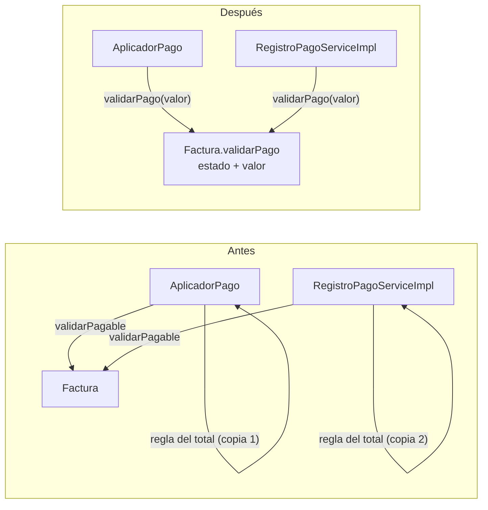
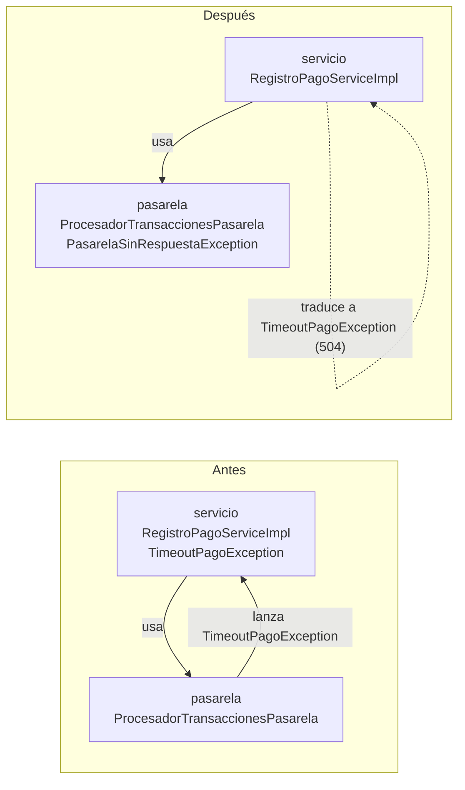

# Diagnóstico técnico y refactorización — F-05 Registrar pago de factura

Taller de refactorización · Ingeniería de Software II · Universidad del Quindío

> **Convenciones.** Las rutas son relativas a `backend/src/main/java/co/edu/uniquindio/epq/`. Los números de
> línea de los hallazgos (secciones 1 a 4) corresponden al commit `e63671b`, es decir, al código **antes** de
> refactorizar.
>
> **Contenido.** Primera parte del taller: secciones 1 a 4 (diagnóstico). Segunda parte: secciones 5 a 10
> (priorización, dos refactorizaciones, verificación, análisis y cierre). Las preguntas de la sesión se responden
> en las secciones 6 y 7, una vez por cada refactorización.

---

## 1. Funcionalidad seleccionada

| Campo | Valor |
|---|---|
| Equipo | Angelica María Reyes, Steven Severino, Andrés Felipe Zambrano |
| Repositorio | <https://github.com/AgriDulce7u7/Proyecto_Ingenieria_Software_2> |
| Funcionalidad | **F-05 Registrar pago de factura** (CU-04) |
| Requisitos | SWR-21 a SWR-24, RN-05 (la factura pasa a *Pagada* solo con confirmación), CO-02 (pago por el total, timeout y reintentos de la pasarela) |
| Arquitectura documentada | `ARQUITECTURA.md`: monolito modular con capas `web`, `servicio`, `dominio`, `repositorio`, `evento`, `tarea` (§5.4) |

**Por qué esta funcionalidad.** Es una transacción de negocio que involucra varias entidades (`Factura`, `Pago`,
`IntentoPagoEnLinea`) y un sistema externo (pasarela de pagos), y tiene dos flujos: pago presencial registrado
por un funcionario y pago en línea del ciudadano.

### Componentes que participan

| Capa | Componente | Responsabilidad |
|---|---|---|
| web | `pagos/web/PagoController` | `POST /api/pagos/presenciales` |
| web | `portal/web/PortalCiudadanoController` | `POST /api/portal/facturas/{numero}/pago-en-linea` |
| servicio | `pagos/servicio/impl/RegistroPagoServiceImpl` | Orquesta los dos flujos y registra los intentos en línea |
| servicio | `pagos/servicio/AplicadorPago` | En una transacción: bloquea la factura, crea el `Pago`, la marca pagada, audita y publica el evento |
| pasarela | `pagos/pasarela/ProcesadorTransaccionesPasarela` | Timeout por intento y reintentos (CO-02) |
| dominio | `facturacion/dominio/Factura` | `validarPagable()`, `registrarPago()` y máquina de estados de cobro |
| repositorio | `FacturaRepository`, `PagoRepository`, `IntentoPagoEnLineaRepository` | Persistencia (bloqueo pesimista sobre la factura) |

---

## 2. Cobertura de los hallazgos

| Aspecto pedido | H-01 | H-02 | H-03 |
|---|:---:|:---:|:---:|
| Arquitectura | ✔ | | |
| Principios SOLID | ✔ (DIP) | ✔ (SRP) | |
| Responsabilidades / separación de capas | ✔ | ✔ | ✔ |
| Código limpio / duplicación de código | | ✔ | ✔ |
| Acoplamiento | ✔ | | ✔ |

---

## 3. Hallazgos

### H-01 · El servicio de pagos depende de los DTO de la capa web

| Campo | Contenido |
|---|---|
| Tipo | Riesgo arquitectónico |
| Ubicación | `pagos/servicio/RegistroPagoService.java` (interfaz), l. 3-5, 13 y 16; `pagos/servicio/impl/RegistroPagoServiceImpl.java` l. 37-39; `pagos/servicio/PagosMapper.java` l. 128-130 |
| Criterio | Regla de dependencia entre capas (`ARQUITECTURA.md` §5.4); Principio de Inversión de Dependencias (DIP); acoplamiento |

**Evidencia** (`RegistroPagoService.java`):

```java
import co.edu.uniquindio.epq.pagos.web.dto.ComprobantePagoResponse;
import co.edu.uniquindio.epq.pagos.web.dto.PagoEnLineaRequest;
import co.edu.uniquindio.epq.pagos.web.dto.RegistrarPagoPresencialRequest;
...
ComprobantePagoResponse registrarPresencial(RegistrarPagoPresencialRequest solicitud);
ComprobantePagoResponse pagarEnLinea(String numeroFactura, PagoEnLineaRequest solicitud);
```

**Observación.** El contrato del caso de uso (la interfaz del servicio) recibe y devuelve objetos del paquete
`pagos.web.dto`. Al mismo tiempo, los controladores de `web` dependen del servicio. Resultado: `web → servicio`
y `servicio → web`, un ciclo entre capas.

**Justificación.**

1. **Contradice la arquitectura documentada.** `ARQUITECTURA.md` §5.4 dice que `web` "solo conoce `servicio`"
   y que `servicio` "depende de `dominio`, `repositorio` y puertos externos". La capa web no está en esa lista.
   Es una regla escrita por el propio equipo, no un criterio externo.
2. **Viola DIP.** El DIP pide que los módulos de alto nivel (el caso de uso "registrar pago") no dependan de
   detalles de bajo nivel (el formato HTTP/JSON de entrada y salida). Aquí la política depende del detalle:
   `PagoEnLineaRequest` y `RegistrarPagoPresencialRequest` llevan anotaciones de Bean Validation (`@NotBlank`,
   `@Pattern`, `@Digits`), que son validaciones de formato de la petición HTTP, y `ComprobantePagoResponse` es
   la forma exacta del JSON que recibe el cliente.
3. **Genera acoplamiento real, no teórico.** Cualquier cambio en el contrato JSON (renombrar un campo para el
   frontend, versionar la API) obliga a modificar la interfaz del servicio y su implementación. Si mañana el
   pago se registrara desde otro canal (una tarea programada, un archivo de recaudo bancario), ese canal tendría
   que construir objetos de la capa web para invocar el caso de uso.
4. **Es sistémico.** No es un descuido aislado: 56 archivos bajo `*/servicio` importan clases de `*.web.*`
   (auditoría, cartera, comercial, dashboard, facturación, pagos). Esto refuerza que es una decisión de diseño
   no alineada con la arquitectura, no un error puntual.

**Límite del hallazgo.** No produce fallos funcionales hoy: el sistema funciona correctamente. Es un riesgo de
mantenibilidad y evolución, por eso se clasifica como riesgo arquitectónico y no como defecto.

**Impacto y riesgo.** Medio. Afecta la capacidad de cambiar la API o reutilizar los casos de uso sin tocar la
lógica de negocio.

---

### H-02 · La regla "el pago debe ser por el total" está duplicada en dos servicios y fuera del dominio

| Campo | Contenido |
|---|---|
| Tipo | Deuda técnica |
| Ubicación | `pagos/servicio/AplicadorPago.java`, método `aplicar`, l. 56-60; `pagos/servicio/impl/RegistroPagoServiceImpl.java`, método `pagarEnLinea`, l. 95-99; comparar con `facturacion/dominio/Factura.java`, `validarPagable`, l. 163-174 |
| Criterio | Duplicación de código (DRY); responsabilidad mal ubicada (SRP / Experto en Información); regla de capas §5.4 |

**Evidencia.**

```java
// AplicadorPago.java:56-60
factura.validarPagable();   // SWR-23
if (valor.compareTo(factura.getTotal()) != 0) {
    throw new ReglaNegocioException("El valor %s no coincide con el total de la factura %s (%s)"
            .formatted(valor, factura.getNumeroFactura(), factura.getTotal()));
}
```

```java
// RegistroPagoServiceImpl.java:95-99
factura.validarPagable();                                   // SWR-23
BigDecimal monto = factura.getTotal();
if (s.valor() != null && s.valor().compareTo(monto) != 0) {  // CO-02: el monto coincide con el total
    throw new ReglaNegocioException("El valor a pagar debe ser el total de la factura: " + monto);
}
```

**Observación.** La regla de negocio CO-02 ("no se admiten pagos parciales") se implementa dos veces, en dos
clases de la capa de servicio, con dos mensajes de error diferentes. Las demás reglas que deciden si una factura
puede pagarse (pagada, anulada, incluida en un acuerdo) sí están en la entidad: `Factura.validarPagable()`.

**Justificación.**

1. **Duplicación con divergencia comprobada.** No es solo código repetido: las dos copias ya evolucionaron por
   separado (mensajes distintos). Si la política cambia (por ejemplo, aceptar abonos o una tolerancia por
   redondeo), hay que recordar cambiar los dos lugares; olvidar uno deja al pago presencial y al pago en línea
   con reglas diferentes.
2. **La regla está en la capa equivocada.** `ARQUITECTURA.md` §5.4 asigna al `dominio` "entidades, estados y
   reglas de negocio", y el Javadoc de `Factura` la describe como "entidad rica: controla sus propias
   transiciones". `Factura` tiene el dato (`total`) y ya concentra las demás reglas de cobro; según el principio
   de Experto en Información, es quien debe decidir si un valor es válido para pagarla.
3. **Responsabilidad única.** Los servicios tienen como responsabilidad orquestar (buscar la factura, llamar
   a la pasarela, persistir, auditar). Al decidir además la política de valores de una factura, asumen una razón
   de cambio que pertenece al dominio: un cambio en la política de pagos parciales obligaría a modificar dos
   orquestadores que no deberían conocerla.

**Matiz (evita sobredimensionar el hallazgo).** Que `pagarEnLinea` valide **antes** de cobrar la tarjeta es
correcto: falla temprano y evita un cobro que luego no podría aplicarse. El problema no es que se valide dos
veces, sino que la regla no tiene un único dueño.

**Impacto y riesgo.** Medio. Hoy ambas copias son consistentes en lógica; el riesgo aparece cuando la regla
cambie.

---

### H-03 · La capa de pasarela depende de la capa de servicio y se comunica con ella mediante un mapa sin tipo

| Campo | Contenido |
|---|---|
| Tipo | Oportunidad de mejora |
| Ubicación | `pagos/pasarela/ProcesadorTransaccionesPasarela.java` l. 14 y 58; `pagos/servicio/TimeoutPagoException.java`; `pagos/servicio/impl/RegistroPagoServiceImpl.java` l. 27, 36 y 112-114; `comun/excepcion/ExcepcionAplicacion.java` l. 27 y 31-38 |
| Criterio | Acoplamiento (Principio de Dependencias Acíclicas); separación de capas; código limpio (tipado explícito) |

**Evidencia.**

```java
// ProcesadorTransaccionesPasarela.java (paquete pasarela)
14  import co.edu.uniquindio.epq.pagos.servicio.TimeoutPagoException;
58  throw new TimeoutPagoException(maximo);
```

```java
// RegistroPagoServiceImpl.java (paquete servicio)
27  import co.edu.uniquindio.epq.pagos.pasarela.ProcesadorTransaccionesPasarela;
112 } catch (TimeoutPagoException ex) {
113     registrarIntento(factura, monto, ResultadoIntentoPago.SIN_RESPUESTA, null, null, ex.getMessage(),
114             tarjeta, (Integer) ex.propiedades().get("intentos"), usuario);
```

```java
// ExcepcionAplicacion.java (superclase de TimeoutPagoException)
27  public abstract HttpStatus estadoHttp();
31  /** Agrega un dato adicional que viajará en la respuesta de error (p. ej. el perfil existente). */
```

**Observación.** El paquete `pasarela` (adaptación del sistema externo) importa una excepción del paquete
`servicio`, mientras `servicio` importa `pasarela`: hay un ciclo de dependencias. Además, el número de intentos
realizados viaja desde el procesador hasta el servicio guardado en `propiedades()`, un `Map<String, Object>`
pensado para agregar datos a la respuesta HTTP de error, y se recupera con una clave de texto y un cast.

**Justificación.**

1. **Acoplamiento cíclico.** El Principio de Dependencias Acíclicas exige que el grafo de dependencias entre
   paquetes no tenga ciclos. Con el ciclo `servicio ↔ pasarela`, ninguno de los dos paquetes puede entenderse,
   probarse o reemplazarse de forma independiente. Esto debilita la decisión D3 de `ARQUITECTURA.md`
   ("integraciones detrás de interfaces"), cuyo propósito es aislar el sistema externo.
2. **La infraestructura queda acoplada a HTTP.** `TimeoutPagoException` hereda de `ExcepcionAplicacion`, que
   declara `estadoHttp()` (devuelve un `HttpStatus` de Spring Web). Por eso el procesador de la pasarela, que no
   debería saber nada de HTTP, lanza una excepción que conoce su código de respuesta (504). La traducción a
   HTTP corresponde a la capa `web` (§5.4: "códigos de error").
3. **Comunicación por un canal sin tipo (código limpio).** `(Integer) ex.propiedades().get("intentos")`
   depende de una cadena literal y de un cast que el compilador no verifica. Si alguien renombra la propiedad en
   el constructor de `TimeoutPagoException` o cambia su tipo, el error no aparece al compilar sino en tiempo de
   ejecución (`null` o `ClassCastException`), justo en la rama de timeout, que es la menos probada. Además, se
   reutiliza un mapa cuyo propósito documentado (l. 31) es la respuesta de error, no el paso de datos entre
   componentes.
4. **Dato potencialmente incorrecto.** Si el hilo se interrumpe (`InterruptedException`, l. 53-55), el ciclo
   se corta con `break` y la l. 58 lanza `TimeoutPagoException(maximo)`, reportando el máximo de intentos aunque
   se hayan hecho menos. Ese valor es el que termina guardado en `IntentoPagoEnLinea`.

**Límite del hallazgo.** El impacto funcional es bajo: el flujo normal funciona y el punto 4 solo ocurre ante una
interrupción del hilo. Por eso se clasifica como oportunidad de mejora y no como defecto.

**Impacto y riesgo.** Bajo en lo funcional, medio en mantenibilidad: el ciclo y el cast sin tipo hacen frágil
la rama de timeout.

---

## 4. Resumen

| ID | Hallazgo | Tipo | Criterio principal | Impacto | Estado |
|---|---|---|---|---|---|
| H-01 | El servicio depende de DTO de la capa web | Riesgo arquitectónico | Capas §5.4, DIP, acoplamiento | Medio | Pendiente (sección 9) |
| H-02 | Regla "pago por el total" duplicada y fuera del dominio | Deuda técnica | DRY, SRP / Experto en Información | Medio | **Refactorizado** (sección 6) |
| H-03 | Ciclo `pasarela ↔ servicio` y datos por un mapa sin tipo | Oportunidad de mejora | Acoplamiento (ADP), capas, código limpio | Bajo | **Refactorizado** (sección 7) |

---

# Segunda parte — Refactorización

## 5. Revisión y priorización de los hallazgos

Cada hallazgo se calificó de 1 a 3 en cuatro criterios. **Prioridad = beneficio + riesgo − esfuerzo − riesgo de
romper algo**: se eligen primero los cambios que mejoran más y que se pueden demostrar con menos riesgo.

| ID | Beneficio | Riesgo si no se corrige | Esfuerzo | Riesgo de romper algo | Prioridad | Decisión |
|---|---|---|---|---|---|---|
| H-02 | 3 | 2 | 1 | 1 | **3** | **Primera refactorización** |
| H-03 | 2 | 1 | 1 | 1 | **1** | **Segunda refactorización** |
| H-01 | 3 | 2 | 3 | 2 | 0 | Se pospone (sección 9) |

**Razones.**

- **H-02 primero.** Es una regla de negocio (dinero del usuario) que ya tiene dos versiones con mensajes
  distintos; corregirla deja un único dueño de la regla. El cambio toca tres archivos y se demuestra con
  pruebas unitarias del dominio.
- **H-03 segundo.** Su impacto funcional es bajo, pero es el único hallazgo de **acoplamiento entre paquetes**
  que se puede eliminar por completo en esta sesión, y el cambio es pequeño y local al módulo de pagos.
- **H-01 se pospone.** Tiene alto beneficio, pero el problema está repetido en 56 archivos de casi todos los
  módulos. Corregirlo solo en pagos dejaría el proyecto inconsistente, y corregirlo en todos excede una sesión.
  Se registra como deuda técnica con un plan (sección 9).

**Red de seguridad antes de refactorizar.** F-05 no tenía pruebas del servicio, del aplicador ni del procesador
de la pasarela. Antes de cambiar código se escribieron **pruebas de caracterización** sobre el código original
(commit `7b08875`): fijan lo que el sistema hace hoy, incluidos los casos de error. La condición de éxito de
ambas refactorizaciones es que esas pruebas pasen **sin modificarse** antes y después.

| Clase de prueba (nueva) | Pruebas | Qué fija |
|---|---|---|
| `pagos/servicio/AplicadorPagoTest` | 8 | Pago por el total, comparación por monto, valor distinto, factura pagada / en acuerdo / inexistente, RN-05 |
| `pagos/servicio/impl/RegistroPagoServiceImplTest` | 14 | Flujo presencial y en línea: factura ajena, rechazo, timeout (con el procesador real), cobro aprobado no aplicable, pagos simultáneos |
| `pagos/pasarela/ProcesadorTransaccionesPasarelaTest` | 7 | Política CO-02: aprobación, rechazo sin reintento, reintento por falla técnica, error inesperado, agotamiento de intentos, timeout |

---

## 6. Primera refactorización — H-02: la regla del valor del pago pasa al dominio

**Commit:** `b1fcb9f` — *refactor: centralizar en Factura la validacion del valor del pago*

### 6.1 ¿Cuál era el problema identificado y dónde estaba localizado?

La regla de negocio CO-02, "el pago debe ser por el total de la factura; no se admiten pagos parciales", estaba
**escrita dos veces en la capa de servicio** y no en la entidad que posee el dato:

| Ubicación (antes) | Código | Mensaje |
|---|---|---|
| `pagos/servicio/AplicadorPago.java`, `aplicar`, l. 56-60 | `if (valor.compareTo(factura.getTotal()) != 0)` | "El valor X no coincide con el total de la factura N (T)" |
| `pagos/servicio/impl/RegistroPagoServiceImpl.java`, `pagarEnLinea`, l. 95-99 | `if (s.valor() != null && s.valor().compareTo(monto) != 0)` | "El valor a pagar debe ser el total de la factura: T" |

Las otras reglas que deciden si una factura se puede pagar (ya pagada, anulada, en acuerdo de pago) sí estaban en
`facturacion/dominio/Factura.java`, método `validarPagable()`.

### 6.2 ¿Qué principio de diseño o atributo de calidad estaba comprometido?

- **DRY (no repetirse):** una misma regla con dos implementaciones que ya habían divergido (mensajes distintos).
- **SRP / Experto en Información (GRASP):** los servicios, cuya responsabilidad es orquestar, también decidían
  una política de la factura. El experto es `Factura`: tiene el `total` y ya concentra las reglas de cobro.
- **Separación de capas:** `ARQUITECTURA.md` §5.4 asigna las reglas de negocio a la capa `dominio`.
- **Atributo de calidad: mantenibilidad** (modificabilidad). Cambiar la política exigía encontrar y modificar
  dos lugares; olvidar uno dejaba al pago presencial y al pago en línea con reglas diferentes.

### 6.3 ¿Qué modificación realizaron y cómo cambiaron las responsabilidades o dependencias?

Se creó en la entidad un método que valida **estado y valor** en un solo lugar, y los dos servicios lo usan:

```java
// facturacion/dominio/Factura.java (nuevo, l. 181)
public void validarPago(BigDecimal valor) {
    validarPagable();                                   // 1.º el estado (pagada, anulada, en acuerdo)
    if (Objects.requireNonNull(valor, "El valor del pago es obligatorio").compareTo(total) != 0) {
        throw new ReglaNegocioException("El valor %s no coincide con el total de la factura %s (%s)"
                .formatted(valor, numeroFactura, total));
    }
}
```

| Archivo | Antes | Después |
|---|---|---|
| `AplicadorPago.aplicar` (l. 55) | `validarPagable()` + `if` propio | `factura.validarPago(valor)` |
| `RegistroPagoServiceImpl.pagarEnLinea` (l. 98) | `validarPagable()` + `if` propio | `factura.validarPago(s.valor() == null ? monto : s.valor())` |



**Cambio de responsabilidades.** `Factura` pasa a ser la única dueña de la decisión "¿se puede pagar esta factura
con este valor?". Los servicios conservan solo la orquestación: cuándo validar (el pago en línea sigue validando
**antes** de cobrar la tarjeta para fallar temprano) y qué hacer después. Las dependencias entre clases no
cambian: los servicios ya dependían de `Factura`.

**Decisiones para conservar el comportamiento.** Se mantuvo el orden de validación (primero el estado, luego el
valor), la comparación por monto con `compareTo` (81783.25 = 81783.250) y la firma de `registrarPago`, que también
usa el módulo de cartera.

### 6.4 ¿Qué consecuencias tiene el cambio sobre la arquitectura de la aplicación?

- **Se cumple la regla de capas §5.4** para esta regla de negocio: vuelve a la capa `dominio`.
- **Modelo de dominio más rico y coherente:** todas las reglas de cobro de la factura están ahora en
  `Factura` y se pueden probar sin Spring, sin base de datos y sin dobles.
- **Punto único de cambio:** si mañana se aceptan abonos o una tolerancia por redondeo, se modifica un método y
  ambos canales (presencial y en línea) heredan el cambio.
- **Consecuencia observable declarada:** al unificar la regla se unificó el mensaje. En el pago en línea con un
  valor distinto del total, el error sigue siendo HTTP 422, pero su texto pasa de "El valor a pagar debe ser el
  total de la factura: T" a "El valor X no coincide con el total de la factura N (T)". La pantalla del ciudadano
  siempre envía `valor = factura.total` (`frontend/src/paginas/ciudadano/cuenta/PagarFactura.jsx:121`), así que
  este caso solo aparece llamando la API directamente. Se considera una mejora de consistencia, no un defecto.

### 6.5 ¿Qué evidencias demuestran que la funcionalidad conserva su comportamiento?

1. **Pruebas de caracterización sin cambios** (`AplicadorPagoTest`, `RegistroPagoServiceImplTest`) escritas
   sobre el código original; deben pasar en el commit `7b08875` (antes) y en `b1fcb9f` (después). Cubren, entre
   otros: pago por el total, `81783.250` aceptado, valor distinto rechazado **sin guardar ni publicar el evento**,
   el estado se valida antes que el valor, y en línea el valor incorrecto se rechaza **antes de llamar a la
   pasarela**.
2. **Pruebas nuevas del dominio** en `FacturaCobroTest` (de 8 a 11): `validarPago` acepta el total, rechaza otro
   valor sin cambiar el estado, revisa primero el estado y rechaza una factura en acuerdo aunque el valor sea el
   total.
3. **Las 8 pruebas que ya existían** en `FacturaCobroTest` no se modificaron.
4. **Comprobación manual** en Swagger (tabla 8.3).

---

## 7. Segunda refactorización — H-03: se elimina el ciclo entre pasarela y servicio

**Commit:** `b7d4111` — *refactor: eliminar la dependencia de la pasarela hacia el servicio de pagos*

### 7.1 ¿Cuál era el problema identificado y dónde estaba localizado?

`pagos/pasarela/ProcesadorTransaccionesPasarela.java` (capa de integración con el sistema externo) importaba
`TimeoutPagoException` del paquete `pagos/servicio` (l. 14) y la lanzaba al agotar los intentos (l. 58). A su
vez, `pagos/servicio/impl/RegistroPagoServiceImpl.java` importa el procesador: **ciclo `servicio ↔ pasarela`**.

Además, el número de intentos viajaba del procesador al servicio dentro de `propiedades()`, un
`Map<String, Object>` de `ExcepcionAplicacion` pensado para la respuesta HTTP de error, y se leía con una clave de
texto y un cast (`RegistroPagoServiceImpl.java` l. 112-114):

```java
} catch (TimeoutPagoException ex) {
    registrarIntento(..., ex.getMessage(), tarjeta, (Integer) ex.propiedades().get("intentos"), usuario);
    throw ex;
}
```

### 7.2 ¿Qué principio de diseño o atributo de calidad estaba comprometido?

- **Principio de Dependencias Acíclicas (ADP):** el grafo de dependencias entre paquetes no debe tener ciclos.
  Con el ciclo, ni la pasarela ni el servicio se pueden entender, probar o reemplazar de forma independiente.
- **Separación de capas / bajo acoplamiento:** la integración (decisión D3 de `ARQUITECTURA.md`: "integraciones
  detrás de interfaces") quedaba atada al caso de uso y, a través de `ExcepcionAplicacion.estadoHttp()`, a HTTP.
  Traducir errores a códigos HTTP corresponde a la capa web, no al adaptador.
- **Código limpio:** comunicación por un canal sin tipo (clave `"intentos"` + cast) que el compilador no verifica.
- **Atributos de calidad:** mantenibilidad y modificabilidad (reemplazar la pasarela o reutilizar el procesador)
  y robustez (un renombre de la clave fallaría solo en tiempo de ejecución, en la rama de timeout).

### 7.3 ¿Qué modificación realizaron y cómo cambiaron las responsabilidades o dependencias?

1. **Nueva excepción propia de la integración**, `pagos/pasarela/PasarelaSinRespuestaException.java`: hereda de
   `RuntimeException` (no conoce HTTP) y expone `int intentos()` con tipo.
2. **El procesador** deja de importar el paquete `servicio` y lanza la nueva excepción (l. 57):
   `throw new PasarelaSinRespuestaException(maximo);`
3. **El servicio traduce** la falla técnica al error del caso de uso, con el mismo mensaje y el mismo código
   HTTP que antes (`RegistroPagoServiceImpl.java` l. 111-117):

```java
} catch (PasarelaSinRespuestaException ex) {
    TimeoutPagoException timeout = new TimeoutPagoException(ex.intentos());
    registrarIntento(factura, monto, ResultadoIntentoPago.SIN_RESPUESTA, null, null, timeout.getMessage(),
            tarjeta, ex.intentos(), usuario);
    throw timeout;
}
```

4. `registrarIntento` recibe `int intentos` en lugar de `Integer` y se elimina el `intentos == null ? 1 : intentos`,
   que ya no tiene caso posible.



**Cambio de responsabilidades.** El procesador solo informa un hecho técnico ("no hubo respuesta en N intentos").
El servicio decide qué significa para el usuario (HTTP 504, mensaje, registro del intento). La dependencia entre
paquetes queda **en un solo sentido**: `servicio → pasarela`.

### 7.4 ¿Qué consecuencias tiene el cambio sobre la arquitectura de la aplicación?

- **Grafo de paquetes acíclico** en el módulo de pagos: `pagos/pasarela` ya no importa nada de `pagos/servicio`
  (verificado: 0 importaciones).
- **Se refuerza la decisión D3:** la integración es un componente independiente del caso de uso; se podría
  reutilizar desde otro servicio (por ejemplo, pagos de cuotas de acuerdos) o sustituir sin tocar `servicio`.
- **La traducción a HTTP queda fuera de la integración**, más cerca de la regla de §5.4 ("web: códigos de error").
  `TimeoutPagoException` sigue existiendo en `servicio` porque es el error del caso de uso.
- **Contrato más seguro:** un cambio en el número de intentos se detecta al compilar, no en producción.
- **Sin cambios externos:** la API, el JSON de error (`intentos`, título, estado 504) y los datos guardados son
  los mismos.

### 7.5 ¿Qué evidencias demuestran que la funcionalidad conserva su comportamiento?

1. **`RegistroPagoServiceImplTest.co02SinRespuestaDeLaPasarelaSeRegistraElIntentoYSePropagaElTimeout`**, escrita
   antes de refactorizar y **sin modificaciones**: usa el **procesador real** con una pasarela que nunca responde.
   Por eso no depende de qué excepción interna use la pasarela y compara el comportamiento observable: el
   servicio lanza `TimeoutPagoException` con estado `GATEWAY_TIMEOUT`, propiedad `intentos = 2`, mensaje
   "…no respondió después de 2 intentos…", guarda un intento `SIN_RESPUESTA` con ese mismo mensaje y 2 intentos,
   llama a la pasarela 2 veces y no aplica el pago.
2. **`ProcesadorTransaccionesPasarelaTest`**: sus 7 pruebas de caracterización (aprobación, rechazo sin reintento,
   reintento por falla técnica, error inesperado, agotamiento de intentos, timeout, mínimo un intento) pasan
   sin cambios; se agregó 1 prueba nueva que fija el contrato tipado (`intentos() == 2`).
3. **Verificación estructural:** búsqueda de `import co.edu.uniquindio.epq.pagos.servicio` en `pagos/pasarela/`:
   1 resultado antes, 0 después.

---

## 8. Verificación y análisis de la mejora

### 8.1 Métricas antes y después

Obtenidas con `git grep` sobre `e63671b` (antes) y `b7d4111` (después).

| Métrica | Antes | Después | Hallazgo |
|---|---|---|---|
| Comparaciones del valor contra el total en servicios de pagos | 2 | 0 | H-02 |
| Implementaciones de la regla en el dominio (`Factura`) | 0 | 1 | H-02 |
| Mensajes distintos para la misma regla | 2 | 1 | H-02 |
| Importaciones de `pagos/pasarela` hacia `pagos/servicio` (ciclo) | 1 | 0 | H-03 |
| Casts desde `propiedades()` en el módulo de pagos | 1 | 0 | H-03 |
| Pruebas (`@Test`) del módulo de pagos | 5 | 35 | Red de seguridad |
| Pruebas (`@Test`) de `FacturaCobroTest` | 8 | 11 | H-02 |

**Análisis.** Las dos refactorizaciones son pequeñas (≈ 50 líneas de código de producción) pero eliminan las
causas, no los síntomas: la regla de negocio tiene ahora un solo dueño y el ciclo de dependencias desapareció.
La mejora más grande en calidad no está en las líneas cambiadas sino en las **30 pruebas nuevas del módulo de
pagos**: antes, ninguna refactorización de F-05 se podía demostrar; ahora cada rama crítica (rechazo, timeout,
factura ajena, cobro aprobado no aplicable, pagos simultáneos) está protegida.

### 8.2 Procedimiento antes/después

Desde `backend/`. No se necesita la base de datos: son pruebas unitarias con dobles (Mockito).

```bash
CLASES='AplicadorPagoTest,RegistroPagoServiceImplTest,ProcesadorTransaccionesPasarelaTest,FacturaCobroTest'

git checkout 7b08875   # ANTES: código original + pruebas de caracterización
./mvnw test -Dtest="$CLASES" | tee ../docs/refactorizacion/evidencias/antes.txt

git checkout b1fcb9f   # Después de la primera refactorización (H-02)
./mvnw test -Dtest="$CLASES" | tee ../docs/refactorizacion/evidencias/despues-h02.txt

git checkout b7d4111   # Después de la segunda refactorización (H-03)
./mvnw test -Dtest="$CLASES" | tee ../docs/refactorizacion/evidencias/despues-h03.txt
./mvnw test | tee ../docs/refactorizacion/evidencias/suite-completa.txt   # sin regresiones en otros módulos
```

### 8.3 Comprobación manual (Swagger: `http://localhost:8080/swagger-ui.html`)

| Caso | Antes | Después |
|---|---|---|
| `POST /api/pagos/presenciales` por el total | 201 + comprobante | Igual |
| `POST /api/pagos/presenciales` con otro valor | 422 "El valor … no coincide con el total…" | Igual |
| `POST /api/pagos/presenciales` sobre factura pagada | 422 "…ya se encuentra pagada" | Igual |
| Pago en línea con tarjeta de prueba `4111111111111111` | 201 + comprobante | Igual |
| Pago en línea con `valor` distinto del total | 422 "El valor a pagar debe ser el total…" | 422 "El valor … no coincide con el total…" (6.4) |
| Pago en línea con la pasarela simulada sin respuesta | 504 "Pasarela sin respuesta", `intentos: 2` | Igual |

### 8.4 Resultados

> Completar con la salida real de Maven (`Tests run / Failures / Errors / Skipped`).

| Ejecución | Commit | Pruebas esperadas | Fallos | Errores | Evidencia |
|---|---|---|---|---|---|
| Antes | `7b08875` | 37 (8 + 14 + 7 + 8) | | | `evidencias/antes.txt` |
| Después de H-02 | `b1fcb9f` | 40 (8 + 14 + 7 + 11) | | | `evidencias/despues-h02.txt` |
| Después de H-03 | `b7d4111` | 41 (8 + 14 + 8 + 11) | | | `evidencias/despues-h03.txt` |
| Suite completa | `b7d4111` | | | | `evidencias/suite-completa.txt` |

### 8.5 Limitaciones

- El código y las pruebas se prepararon en un entorno sin acceso a Maven Central, donde **no se pudieron
  ejecutar**. Se hizo una compilación estática de todo el proyecto con `javac`: los únicos errores fueron por
  librerías ausentes (Spring, JPA, JUnit, Mockito), ninguno de sintaxis ni de tipos del proyecto. La evidencia
  válida es la tabla 8.4, que el equipo completa al ejecutar.
- Son pruebas unitarias: no cubren el bloqueo pesimista real ni la restricción `UNIQUE` de PostgreSQL.
- `ProcesadorTransaccionesPasarelaTest.unIntentoQueSuperaElTimeoutSeAbandona` tarda unos segundos porque espera
  un timeout real de 1 s.

---

## 9. Deuda técnica pendiente

| ID | Deuda | Por qué no se hizo ahora | Siguiente paso |
|---|---|---|---|
| H-01 | Los servicios dependen de DTO de la capa web (56 archivos) | Cambio sistémico; hacerlo solo en pagos dejaría el proyecto inconsistente | Comandos y resultados propios del servicio, módulo por módulo, empezando por pagos; regla ArchUnit para evitar regresiones |
| — | Si el hilo se interrumpe, el procesador informa el máximo de intentos aunque haya hecho menos (`ProcesadorTransaccionesPasarela` l. 52-57) | Corregirlo cambia el comportamiento; no es una refactorización pura | Informar el número real de intentos y agregar la prueba correspondiente |
| — | Faltan pruebas `@WebMvcTest` de los endpoints de pago y de integración con la base de datos | Fuera del alcance de la sesión | `@WebMvcTest` para los códigos HTTP y `@DataJpaTest` para el bloqueo y la restricción `UNIQUE` |

---

## 10. Cierre

**Lecciones.**

- **Caracterizar antes de refactorizar.** Sin pruebas no había cómo demostrar que nada cambió. Escribirlas
  primero también obligó a entender el código: la prueba del timeout se diseñó con el procesador real para que
  sirviera antes y después de la segunda refactorización.
- **Refactorizar es mover responsabilidades, no reescribir.** Las dos intervenciones son pequeñas y cada una
  responde a un principio concreto (Experto en Información y ADP).
- **Declarar los cambios observables.** Unificar una regla unificó un mensaje de error; se dejó documentado.
- **Priorizar también es decidir qué no hacer.** H-01 tiene alto beneficio, pero no se podía hacer bien en una
  sesión.

**Vínculo con el proceso (SCRUM).** En un sprint de dos semanas con reunión diaria, estas prácticas evitan que
la deuda se acumule:

- **Definición de Hecho** con pruebas obligatorias de servicio por historia: F-05 se habría entregado con pruebas,
  como F-01 y F-02.
- **Revisión de código en cada pull request** con una lista de verificación de arquitectura (¿la regla está en
  el dominio?, ¿se respetan las dependencias de §5.4?, ¿hay ciclos entre paquetes?).
- **Pruebas de arquitectura automáticas** (ArchUnit) en `./mvnw test`, para que las reglas de capas fallen el build.
- **Deuda técnica en el backlog:** H-01 y los pendientes de la sección 9 entran como historias técnicas del
  siguiente sprint.

**Commits.**

| # | Commit | Mensaje |
|---|---|---|
| Base | `e63671b` | Merge pull request #9 (feature/frontend-entrega-final) |
| 1 | `33c44fc` | docs: registrar diagnostico tecnico |
| 2 | `7b08875` | test: caracterizar el registro de pagos (F-05) |
| 3 | `b1fcb9f` | refactor: centralizar en Factura la validacion del valor del pago |
| 4 | `b7d4111` | refactor: eliminar la dependencia de la pasarela hacia el servicio de pagos |
| 5 | (este documento) | docs: documentar refactorizaciones y verificacion |

Rama: `refactor/taller-f05-pagos` en <https://github.com/AgriDulce7u7/Proyecto_Ingenieria_Software_2>.

**Uso de IA.** Se usó Claude (Anthropic) como apoyo para el análisis, la escritura de pruebas y la redacción.
El equipo debe verificar cada hallazgo, línea y resultado antes de la sustentación.
